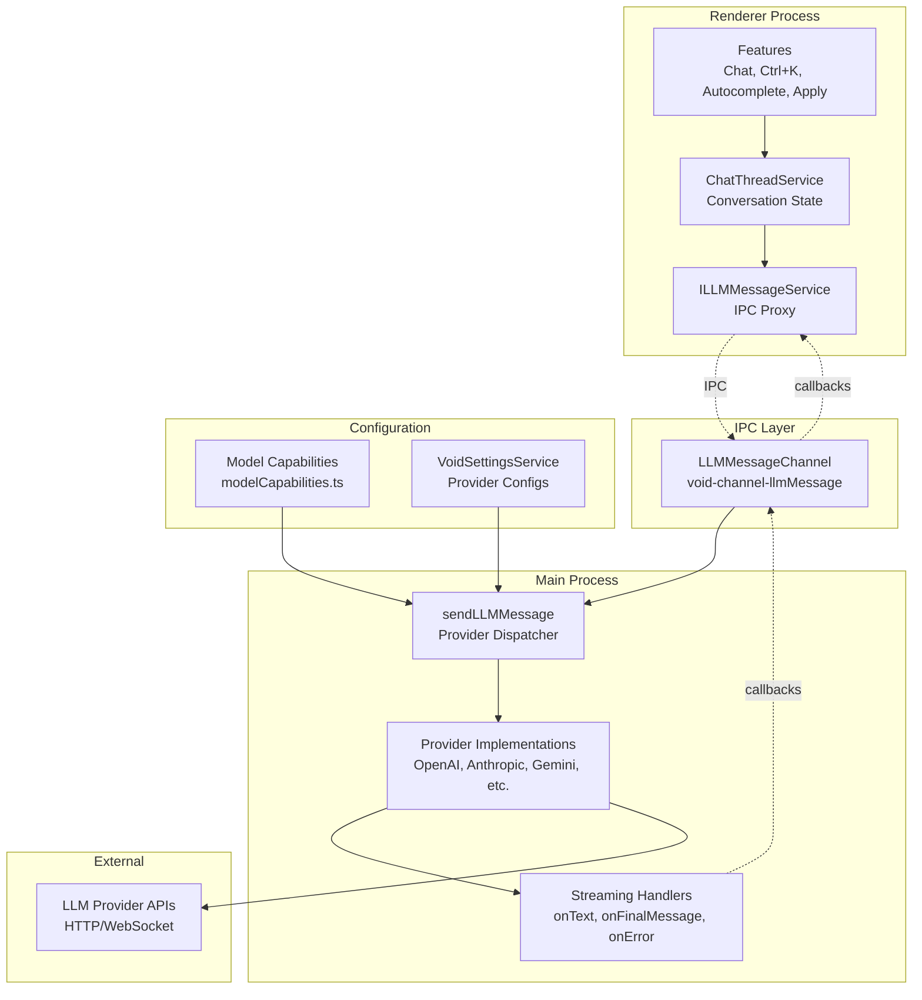
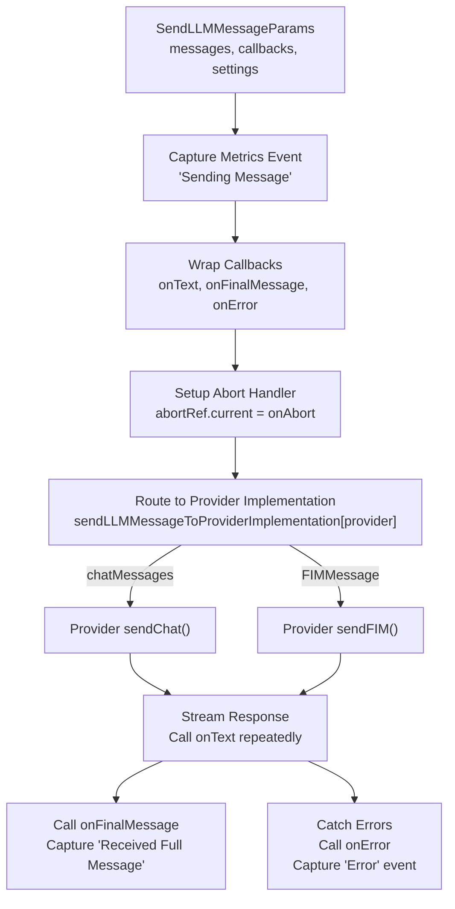
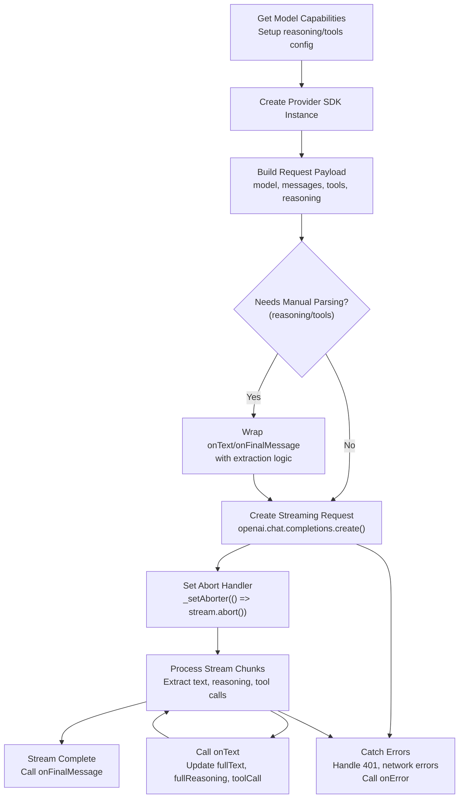

# LLM Integration

<details>
<summary>Relevant source files</summary>

The following files were used as context for generating this wiki page:

- [.voidrules](.voidrules)

</details>


## Purpose and Scope

This document provides a comprehensive overview of Void's LLM integration system, covering how the editor communicates with multiple language model providers to power AI features. The system handles provider abstraction, model capability definitions, message format conversion, and streaming responses.

For implementation details of specific components:
- Message pipeline and dispatch mechanics: see [LLM Message Pipeline and Dispatch](#4.1)
- Individual provider implementations (OpenAI, Anthropic, etc.): see [Provider Implementations](#4.2)
- Model capability definitions and context windows: see [Model Capabilities and Configuration](#4.3)
- Reasoning features and extended thinking: see [Reasoning and Extended Thinking](#4.4)
- Message format translation: see [Message Format Conversion](#4.5)

For related systems:
- Settings and model selection UI: see [Settings and Model Selection](#2.2)
- Service layer coordination: see [LLM Message Service and Provider Abstraction](#3.3)
- Tool execution with LLM calls: see [Tools Service and Terminal Integration](#3.4)

---

## Architecture Overview

Void's LLM integration follows a layered architecture that separates user-facing features from provider-specific implementations. The system runs in Electron's main process to access Node.js APIs and avoid Content Security Policy restrictions in the renderer.

### System Components



**Sources:** [src/vs/workbench/contrib/void/electron-main/llmMessage/sendLLMMessage.ts:12-135](), [src/vs/workbench/contrib/void/electron-main/llmMessage/sendLLMMessage.impl.ts:1-100]()

The architecture separates concerns into distinct layers:

1. **Feature Layer**: User-facing features (Chat, Ctrl+K, Autocomplete, Apply) initiate LLM requests.
2. **Service Layer**: `ChatThreadService` manages conversation state and coordinates calls.
3. **IPC Boundary**: `ILLMMessageService` proxies requests from renderer to main process via `LLMMessageChannel`.
4. **Dispatch Layer**: `sendLLMMessage` routes requests to appropriate provider implementations based on `ProviderName`.
5. **Provider Layer**: Provider-specific implementations in `sendLLMMessage.impl.ts` handle API communication.
6. **Configuration Layer**: `modelCapabilities.ts` and `VoidSettingsService` inform routing and validation.

---

## Provider System

### Provider Types and Registry

Void supports multiple provider types, each with different characteristics:

| Provider Type | Examples | Characteristics |
|--------------|----------|-----------------|
| **Cloud APIs** | Anthropic, OpenAI, Gemini | Require API keys, hosted remotely |
| **Local Servers** | Ollama, vLLM, LM Studio | Auto-detected, run on localhost |
| **Aggregators** | OpenRouter, Groq | Multi-model access via single API |
| **Enterprise** | Google Vertex, Azure, AWS Bedrock | Require complex authentication |
| **Generic** | OpenAI-Compatible | Fallback for custom endpoints |

The complete provider registry is defined in `defaultProviderSettings` [src/vs/workbench/contrib/void/common/modelCapabilities.ts:12-69]():

```typescript
export const defaultProviderSettings = {
	anthropic: { apiKey: '' },
	openAI: { apiKey: '' },
	deepseek: { apiKey: '' },
	ollama: { endpoint: 'http://127.0.0.1:11434' },
	vLLM: { endpoint: 'http://localhost:8000' },
	openRouter: { apiKey: '' },
	openAICompatible: { endpoint: '', apiKey: '', headersJSON: '{}' },
	gemini: { apiKey: '' },
	groq: { apiKey: '' },
	xAI: { apiKey: '' },
	mistral: { apiKey: '' },
	lmStudio: { endpoint: 'http://localhost:1234' },
	liteLLM: { endpoint: '' },
	googleVertex: { region: 'us-west2', project: '' },
	microsoftAzure: { project: '', apiKey: '', azureApiVersion: '2024-05-01-preview' },
	awsBedrock: { apiKey: '', region: 'us-east-1', endpoint: '' },
}
```

**Sources:** [src/vs/workbench/contrib/void/common/modelCapabilities.ts:12-69]()

### Provider Settings Structure

Each provider has a settings structure defined by `SettingsAtProvider<providerName>` in `voidSettingsTypes.ts` [src/vs/workbench/contrib/void/common/voidSettingsTypes.ts:40-50]():

- **Custom settings**: Provider-specific fields (API keys, endpoints, regions).
- **`_didFillInProviderSettings`**: Computed boolean indicating if all required fields are filled.
- **`models`**: Array of `VoidStatefulModelInfo` containing available models.

Models have three categories [src/vs/workbench/contrib/void/common/voidSettingsTypes.ts:32-36]():
- **`default`**: Pre-configured models from `defaultModelsOfProvider`.
- **`autodetected`**: Discovered from local providers (Ollama, vLLM).
- **`custom`**: User-added models.

**Sources:** [src/vs/workbench/contrib/void/common/voidSettingsTypes.ts:40-50](), [src/vs/workbench/contrib/void/common/voidSettingsTypes.ts:32-36]()

### Auto-Detection for Local Providers

Local providers (Ollama, vLLM, LM Studio) support automatic model detection. The `setAutodetectedModels` method [src/vs/workbench/contrib/void/common/voidSettingsService.ts:502-517]() in `VoidSettingsService` swaps in newly detected models while preserving user preferences (hidden state, custom models).

**Sources:** [src/vs/workbench/contrib/void/common/voidSettingsService.ts:502-517]()

---

## Model Capabilities System

### Capability Definitions

Every model has a `VoidStaticModelInfo` definition [src/vs/workbench/contrib/void/common/modelCapabilities.ts:162-203]() that specifies:

| Capability | Description | Example Values |
|------------|-------------|----------------|
| **`contextWindow`** | Maximum input tokens | `200_000`, `1_048_576` |
| **`reservedOutputTokenSpace`** | Reserved output tokens | `4_096`, `8_192`, `null` (default 4096) |
| **`supportsSystemMessage`** | System message handling | `'system-role'`, `'developer-role'`, `'separated'`, `false` |
| **`specialToolFormat`** | Native tool calling format | `'openai-style'`, `'anthropic-style'`, `'gemini-style'`, `undefined` |
| **`supportsFIM`** | Fill-in-middle (autocomplete) | `true`, `false` |
| **`reasoningCapabilities`** | Extended thinking support | Object or `false` |
| **`additionalOpenAIPayload`** | Custom request fields | `{ [key: string]: string }` |

**Sources:** [src/vs/workbench/contrib/void/common/modelCapabilities.ts:162-203]()

### Reasoning Capabilities Structure

Models that support extended thinking have a `reasoningCapabilities` object [src/vs/workbench/contrib/void/common/modelCapabilities.ts:176-190]():

```typescript
reasoningCapabilities: {
	supportsReasoning: true,
	canTurnOffReasoning: boolean,  // Can disable reasoning mode
	canIOReasoning: boolean,        // Can output reasoning text
	reasoningReservedOutputTokenSpace?: number,  // Override for reasoning
	reasoningSlider?: 
		| { type: 'budget_slider'; min; max; default }  // Anthropic-style
		| { type: 'effort_slider'; values; default },    // OpenAI-style
	openSourceThinkTags?: [string, string],  // e.g. ['']
}
```

For details on reasoning features, see [Reasoning and Extended Thinking](#4.4).

**Sources:** [src/vs/workbench/contrib/void/common/modelCapabilities.ts:176-190]()

### Model Capability Lookup

The `getModelCapabilities` function provides runtime capability lookup with fallback logic [src/vs/workbench/contrib/void/common/modelCapabilities.ts:393-471](). It uses pattern matching on model names (e.g., "claude-3-5" → Claude 3.5 Sonnet capabilities) to handle unknown models.

**Sources:** [src/vs/workbench/contrib/void/common/modelCapabilities.ts:393-471]()

---

## Message Dispatch and Streaming

### The sendLLMMessage Dispatcher

The core dispatch function `sendLLMMessage` [src/vs/workbench/contrib/void/electron-main/llmMessage/sendLLMMessage.ts:12-135]() coordinates all LLM requests. It handles metrics capture, callback wrapping, and routing to the correct provider implementation.



**Sources:** [src/vs/workbench/contrib/void/electron-main/llmMessage/sendLLMMessage.ts:12-135]()

### Callback Architecture

The streaming system uses three primary callbacks:

1. **`onText`**: Called repeatedly during streaming with `{ fullText, fullReasoning, toolCall? }`.
2. **`onFinalMessage`**: Called once when complete with `{ fullText, fullReasoning, anthropicReasoning?, toolCall? }`.
3. **`onError`**: Called on any failure with `{ message, fullError }`.

The dispatcher wraps these callbacks to add metrics tracking [src/vs/workbench/contrib/void/electron-main/llmMessage/sendLLMMessage.ts:61-85]().

**Sources:** [src/vs/workbench/contrib/void/electron-main/llmMessage/sendLLMMessage.ts:61-85]()

### Abort Mechanism

Requests can be aborted mid-stream via an `abortRef` [src/vs/workbench/contrib/void/electron-main/llmMessage/sendLLMMessage.ts:57-93](). The provider implementation receives a `_setAborter` function to hook into the underlying request's cancellation mechanism (e.g., `stream.controller.abort()`).

**Sources:** [src/vs/workbench/contrib/void/electron-main/llmMessage/sendLLMMessage.ts:57-93]()

---

## Provider Implementations

### OpenAI-Compatible Providers

Many providers use OpenAI's API format. The `newOpenAICompatibleSDK` function [src/vs/workbench/contrib/void/electron-main/llmMessage/sendLLMMessage.impl.ts:72-172]() creates SDK instances for providers like OpenAI, DeepSeek, Groq, and local servers like Ollama or vLLM.

**Sources:** [src/vs/workbench/contrib/void/electron-main/llmMessage/sendLLMMessage.impl.ts:72-172]()

### Chat Implementation Pattern

All chat implementations follow a standardized pattern for streaming and error handling. Example from `_sendOpenAICompatibleChat` [src/vs/workbench/contrib/void/electron-main/llmMessage/sendLLMMessage.impl.ts:273-388]():



**Sources:** [src/vs/workbench/contrib/void/electron-main/llmMessage/sendLLMMessage.impl.ts:273-388]()

### Native Implementations

Some providers use native SDKs for better compatibility:
- **Anthropic**: Uses `@anthropic-ai/sdk` [src/vs/workbench/contrib/void/electron-main/llmMessage/sendLLMMessage.impl.ts:458-579]().
- **Gemini**: Uses `@google/genai` [src/vs/workbench/contrib/void/electron-main/llmMessage/sendLLMMessage.impl.ts:717-890]().
- **Ollama/Mistral**: Native FIM implementations [src/vs/workbench/contrib/void/electron-main/llmMessage/sendLLMMessage.impl.ts:585-681]().

**Sources:** [src/vs/workbench/contrib/void/electron-main/llmMessage/sendLLMMessage.impl.ts:458-890]()

---

## Model Selection and Configuration

### Model Selection Per Feature

Each feature can have an independent model selection defined in `ModelSelectionOfFeature` [src/vs/workbench/contrib/void/common/voidSettingsTypes.ts:365-367](). For example, **Autocomplete** requires models with `supportsFIM: true`, which is enforced by `modelFilterOfFeatureName` [src/vs/workbench/contrib/void/common/voidSettingsService.ts:107-120]().

**Sources:** [src/vs/workbench/contrib/void/common/voidSettingsTypes.ts:365-367](), [src/vs/workbench/contrib/void/common/voidSettingsService.ts:107-120]()

### Model Overrides

Users can override model capabilities via `OverridesOfModel` [src/vs/workbench/contrib/void/common/voidSettingsTypes.ts:505-509](). Overrides are applied by `getModelCapabilities` and persisted via `VoidSettingsService.setOverridesOfModel` [src/vs/workbench/contrib/void/common/voidSettingsService.ts:477-497]().

**Sources:** [src/vs/workbench/contrib/void/common/voidSettingsTypes.ts:505-509](), [src/vs/workbench/contrib/void/common/voidSettingsService.ts:477-497]()

### Syncing Models Between Features

The settings service supports syncing model selections between features, such as `syncApplyToChat` or `syncSCMToChat` [src/vs/workbench/contrib/void/common/voidSettingsService.ts:403-410]().

**Sources:** [src/vs/workbench/contrib/void/common/voidSettingsService.ts:403-410]()

---

## Error Handling and Metrics

### Error Handling

The system detects and handles several error categories:
- **Authentication**: `401` errors trigger provider-specific instructions [src/vs/workbench/contrib/void/electron-main/llmMessage/sendLLMMessage.impl.ts:205-207]().
- **Network**: Fetch failures suggest endpoint configuration issues.
- **Validation**: Capability checks prevent invalid requests before they are sent.

### Metrics and Logging

All LLM events are captured for analytics in `sendLLMMessage.ts` [src/vs/workbench/contrib/void/electron-main/llmMessage/sendLLMMessage.ts:36-100](). Events include "Sending Message", "Received Full Message", "Error", and "Abort", tracking duration and token counts without capturing message content.

**Sources:** [src/vs/workbench/contrib/void/electron-main/llmMessage/sendLLMMessage.ts:36-100]()