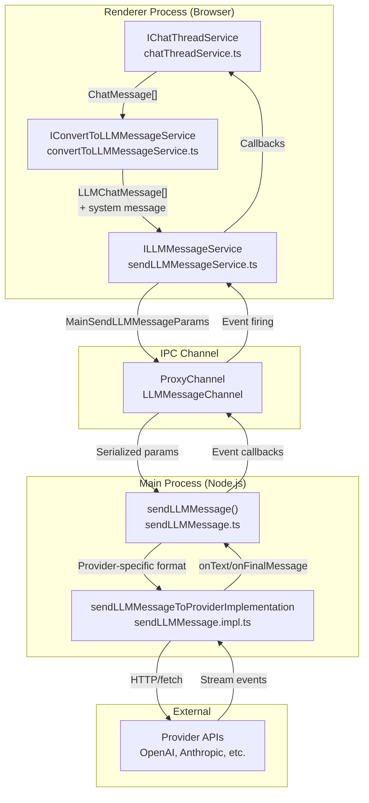
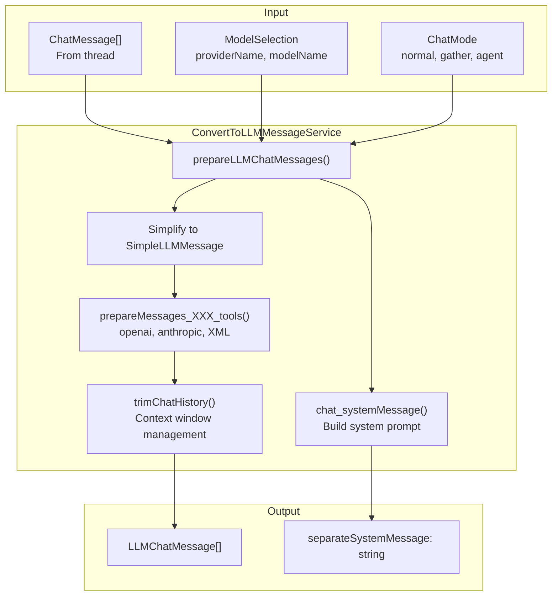
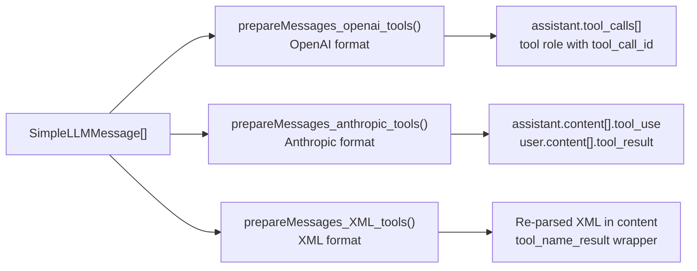
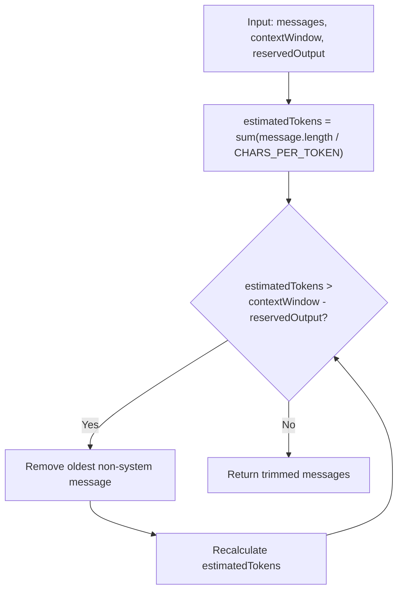
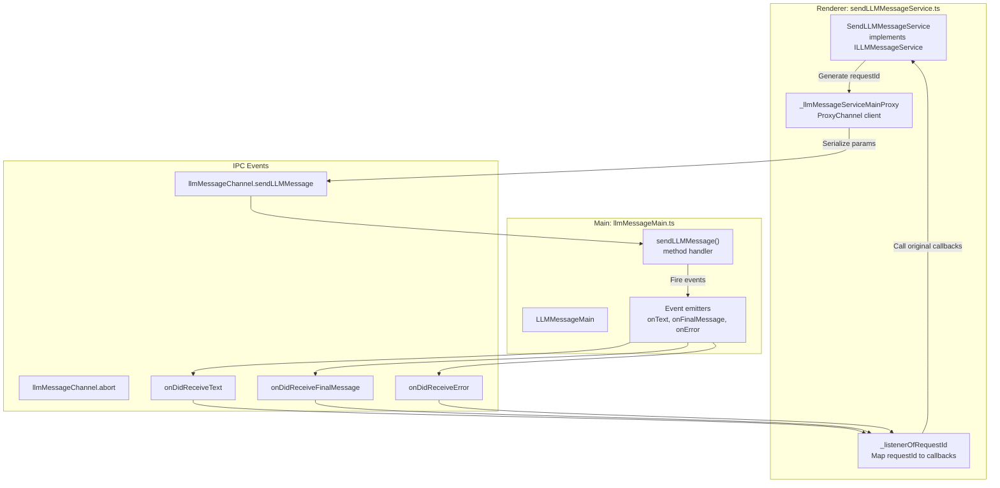
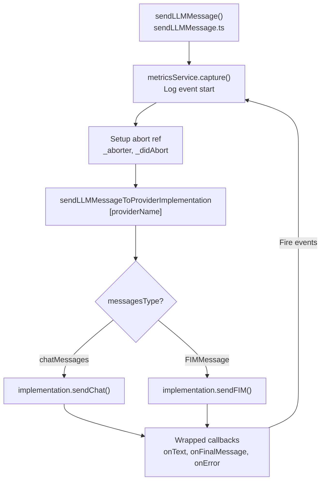
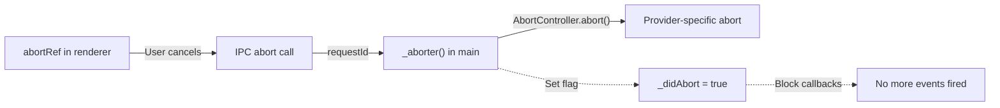
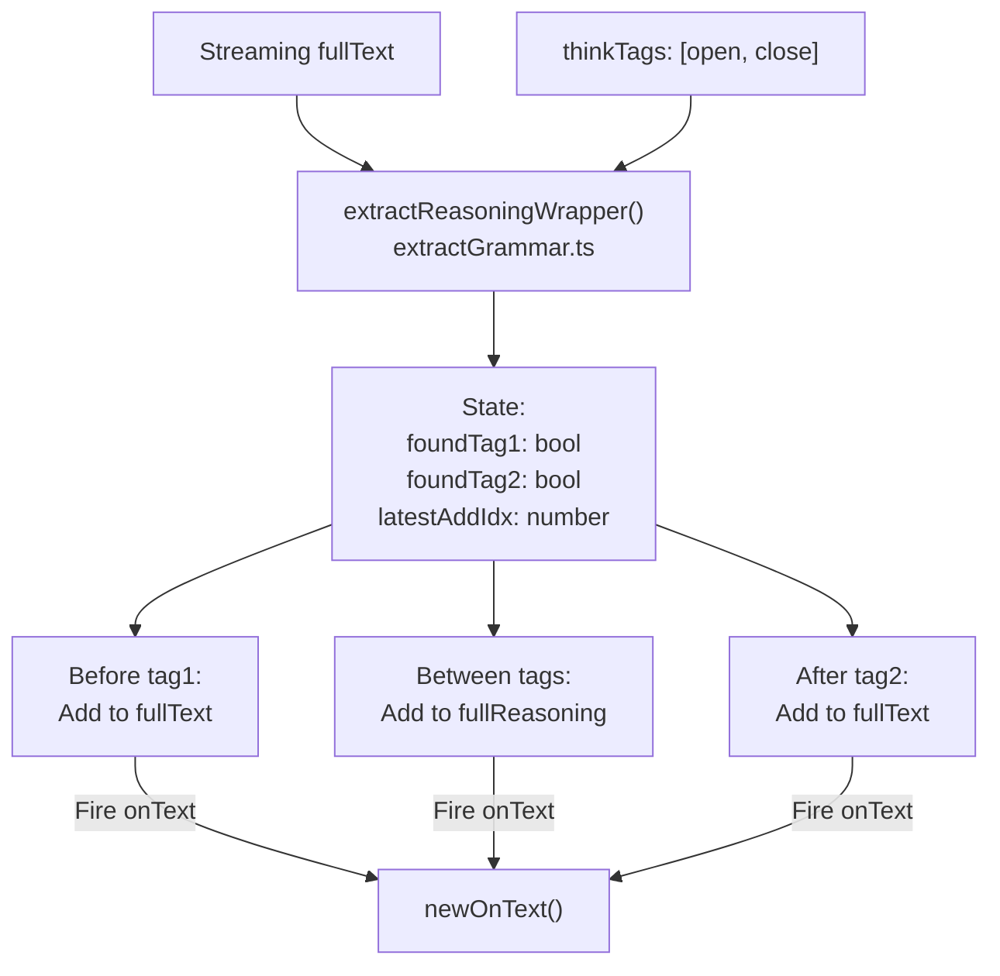
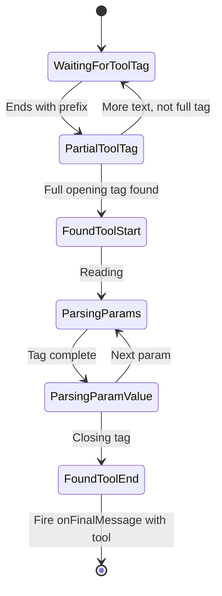

# LLM Message Pipeline and Dispatch

<details>
<summary>Relevant source files</summary>

The following files were used as context for generating this wiki page:

- [.voidrules](.voidrules)

</details>


## Purpose and Scope

This document describes the message pipeline that transforms user interactions into provider-specific API calls. It covers how chat messages from `IChatThreadService` are converted into LLM-compatible formats, dispatched across the IPC boundary to the main process, and sent to provider implementations. This includes context window management, tool call formatting, and reasoning extraction.

For information about chat thread management and tool execution, see [Chat Thread Service and Orchestration](3.1). For provider-specific implementations, see [Provider Implementations](4.2).

---

## Message Pipeline Architecture

The LLM message pipeline consists of three main stages: conversion, dispatch, and provider execution. Messages flow from the renderer process (chat UI) through a conversion service, across IPC channels to the main process, and finally to provider-specific implementations.



**Sources:** [src/vs/workbench/contrib/void/browser/chatThreadService.ts:730-850](), [src/vs/workbench/contrib/void/browser/convertToLLMMessageService.ts:1-50](), [src/vs/workbench/contrib/void/electron-main/llmMessage/sendLLMMessage.ts:1-136]()

---

## Message Conversion Service

The `IConvertToLLMMessageService` transforms internal `ChatMessage[]` arrays into provider-compatible `LLMChatMessage[]` formats. This service handles system message preparation, context window trimming, tool call formatting, and reasoning extraction.

### Conversion Flow



**Sources:** [src/vs/workbench/contrib/void/browser/convertToLLMMessageService.ts:243-348]()

### SimpleLLMMessage Format

The conversion process first simplifies internal `ChatMessage` types to a unified `SimpleLLMMessage` format before converting to provider-specific formats:

| SimpleLLMMessage Type | Fields | Purpose |
|----------------------|--------|---------|
| `role: 'user'` | `content: string` | User input with selections embedded |
| `role: 'assistant'` | `content: string`<br/>`anthropicReasoning: AnthropicReasoning[]` | LLM response with optional reasoning |
| `role: 'tool'` | `content: string`<br/>`id: string`<br/>`name: ToolName`<br/>`rawParams: RawToolParamsObj` | Tool execution results |

**Sources:** [src/vs/workbench/contrib/void/browser/convertToLLMMessageService.ts:26-39]()

### Provider-Specific Tool Formatting

Different providers use different formats for tool calls. The service provides three formatting functions:



#### OpenAI Tool Format
For providers using OpenAI's tool calling convention, assistant messages include a `tool_calls` array, and tool results are returned as `role: 'tool'` messages with a `tool_call_id`.

**Sources:** [src/vs/workbench/contrib/void/browser/convertToLLMMessageService.ts:72-106]()

#### Anthropic Tool Format
Anthropic uses a content array format where tool calls are embedded in assistant messages as `{ type: 'tool_use' }` blocks, and tool results are returned in user messages as `{ type: 'tool_result' }` blocks.

**Sources:** [src/vs/workbench/contrib/void/browser/convertToLLMMessageService.ts:141-196]()

#### XML Tool Format
For providers without native tool support (Gemini, Ollama, etc.), tools are formatted as XML strings. Tool calls are re-parsed from the assistant's output, and results are wrapped in `<tool_name_result>` tags.

**Sources:** [src/vs/workbench/contrib/void/browser/convertToLLMMessageService.ts:199-239]()

---

## Context Window Management

The `trimChatHistory` function ensures messages fit within the model's context window by removing older messages first, preserving the most recent context.

### Trimming Algorithm



The algorithm uses `CHARS_PER_TOKEN = 4` as a conservative estimate and removes messages from the beginning of the history (excluding system messages) until the total fits within the context window minus reserved output space.

**Sources:** [src/vs/workbench/contrib/void/browser/convertToLLMMessageService.ts:43-44](), [src/vs/workbench/contrib/void/browser/convertToLLMMessageService.ts:387-433]()

---

## IPC Dispatch Mechanism

The `ILLMMessageService` in the renderer process communicates with the main process using a proxy channel pattern. This allows the browser context to make privileged API calls without exposing credentials or bypassing CORS restrictions.

### Service Layer Components



**Sources:** [src/vs/workbench/contrib/void/common/sendLLMMessageService.ts:1-199]()

### Request Lifecycle

Each LLM request follows this lifecycle:

1. **Request Initiation**: Service generates a `requestId` using `generateUuid()`
2. **Listener Registration**: Callbacks (`onText`, `onFinalMessage`, `onError`) are stored in `_listenerOfRequestId[requestId]`
3. **Parameter Serialization**: `MainSendLLMMessageParams` includes all data except callbacks
4. **IPC Send**: `sendLLMMessage` method called on proxy, dispatched to main process
5. **Event Callbacks**: Main process fires events with `requestId`, triggering stored listeners
6. **Cleanup**: Listeners removed on final message or error

**Sources:** [src/vs/workbench/contrib/void/common/sendLLMMessageService.ts:45-110]()

---

## Provider Dispatch

The main process `sendLLMMessage` function orchestrates metrics capture, abort handling, and provider selection.

### Main Process Flow



### Callback Wrapping

The main process wraps all callbacks to:
- Check `_didAbort` flag before firing
- Capture metrics events on success/error
- Transform error messages (e.g., "fetch failed" → helpful diagnostic)
- Track message length and duration

**Sources:** [src/vs/workbench/contrib/void/electron-main/llmMessage/sendLLMMessage.ts:12-135]()

### Abort Mechanism



The abort system uses a `_setAborter` callback that providers call to register their abort function (typically an `AbortController`). When abort is triggered, the `_didAbort` flag prevents any further callbacks from firing.

**Sources:** [src/vs/workbench/contrib/void/electron-main/llmMessage/sendLLMMessage.ts:57-94]()

---

## Reasoning Extraction

For models with extended thinking capabilities (o1, Claude with thinking budgets), the pipeline extracts reasoning text from special wrapper tags.

### Reasoning Wrapper Pattern



The wrapper maintains state to track which section of the response is being processed:
1. **Before first tag**: Content goes to `fullTextSoFar`
2. **Between tags**: Content goes to `fullReasoningSoFar`
3. **After second tag**: Content returns to `fullTextSoFar`

On `onFinalMessage`, the wrapper reconstructs the final text by removing the thinking tags and extracting reasoning.

**Sources:** [src/vs/workbench/contrib/void/electron-main/llmMessage/extractGrammar.ts:17-139]()

---

## XML Tool Call Extraction

For providers using XML tool formats, the pipeline extracts tool calls from the streamed text in real-time.

### Tool Extraction State Machine



The extraction process:
1. **Detect partial tags**: Use `endsWithAnyPrefixOf()` to detect partially written opening tags
2. **Parse parameters**: Extract `<param_name>content</param_name>` blocks
3. **Track completion**: Mark each parameter as done when closing tag found
4. **Final tool**: When `</tool_name>` is found, mark tool as `isDone: true`

**Sources:** [src/vs/workbench/contrib/void/electron-main/llmMessage/extractGrammar.ts:146-350]()

### Tool Call Object

The extracted `RawToolCallObj` structure:

```typescript
{
  name: ToolName,              // e.g., 'edit_file'
  rawParams: RawToolParamsObj, // { uri: '...', search_replace_blocks: '...' }
  doneParams: ToolParamName[], // ['uri', 'search_replace_blocks']
  isDone: boolean,             // true when </tool_name> found
  id: string                   // Generated UUID
}
```

**Sources:** [src/vs/workbench/contrib/void/common/sendLLMMessageTypes.ts:81-90]()

---

## System Message Construction

The `chat_systemMessage` function builds the system prompt by combining workspace context, tool definitions, and mode-specific instructions.

### System Message Components

| Component | Source | Purpose |
|-----------|--------|---------|
| Header | Mode-dependent | Defines agent vs assistant role |
| System Info | Workspace context | OS, folders, active file, open files |
| File System Overview | `directoryStr` | Directory tree structure |
| Tool Definitions | `systemToolsXMLPrompt()` | Available tools and parameters |
| Important Details | Mode-dependent rules | Behavior guidelines |

**Sources:** [src/vs/workbench/contrib/void/common/prompt/prompts.ts:428-518]()

### Tool Definitions Format

Tools are defined in XML format with parameter descriptions:

```
Available tools:

1. read_file
Description: Returns full contents of a given file.
Format:
<read_file>
<uri>The FULL path to the file.</uri>
<start_line>Optional. ...</start_line>
<end_line>Optional. ...</end_line>
<page_number>Optional. ...</page_number>
</read_file>

2. edit_file
...
```

The system includes different tool sets based on `chatMode`:
- **normal**: No tools
- **gather**: Read-only tools (read_file, search_*, ls_dir, etc.)
- **agent**: All tools including edit and terminal

**Sources:** [src/vs/workbench/contrib/void/common/prompt/prompts.ts:361-423]()

---

## Message Type Definitions

### SendLLMMessageParams

The complete parameter set for sending messages:

```typescript
type SendLLMMessageParams = {
  // Message content
  messagesType: 'chatMessages' | 'FIMMessage',
  messages: LLMChatMessage[] | LLMFIMMessage,
  separateSystemMessage: string | undefined,
  chatMode: ChatMode | null,
  
  // Callbacks
  onText: (p: {fullText, fullReasoning, toolCall?}) => void,
  onFinalMessage: (p: {fullText, fullReasoning, toolCall?, anthropicReasoning}) => void,
  onError: (p: {message, fullError}) => void,
  abortRef: {current: (() => void) | null},
  
  // Configuration
  modelSelection: ModelSelection,
  modelSelectionOptions: ModelSelectionOptions,
  overridesOfModel: OverridesOfModel,
  settingsOfProvider: SettingsOfProvider,
  mcpTools: InternalToolInfo[],
  
  // Logging
  logging: {loggingName: string, loggingExtras?: object}
}
```

**Sources:** [src/vs/workbench/contrib/void/common/sendLLMMessageTypes.ts:125-138]()

### Cross-Process Type Transformation

When passing through IPC, function parameters are replaced with event-based alternatives:

```typescript
// Renderer service receives:
ServiceSendLLMMessageParams = {
  onText, onFinalMessage, onError, onAbort  // Functions
}

// Main process receives:
MainSendLLMMessageParams = {
  requestId: string  // Instead of callbacks
}

// Events fired back:
EventLLMMessageOnTextParams = {fullText, fullReasoning, toolCall?, requestId}
EventLLMMessageOnFinalMessageParams = {..., requestId}
EventLLMMessageOnErrorParams = {message, fullError, requestId}
```

**Sources:** [src/vs/workbench/contrib/void/common/sendLLMMessageTypes.ts:143-150]()

---

## Key Classes and Functions

### ConvertToLLMMessageService

| Method | Purpose |
|--------|---------|
| `prepareLLMChatMessages()` | Main entry point for message conversion |
| `prepareMessages_openai_tools()` | Format for OpenAI-compatible providers |
| `prepareMessages_anthropic_tools()` | Format for Anthropic |
| `prepareMessages_XML_tools()` | Format for XML-based tool calling |
| `trimChatHistory()` | Context window management |

**Sources:** [src/vs/workbench/contrib/void/browser/convertToLLMMessageService.ts:48-433]()

### SendLLMMessageService

| Method | Purpose |
|--------|---------|
| `sendLLMMessage()` | Service entry point, registers listeners and dispatches |
| `abortLLMMessage()` | Cancel in-flight request |
| `_setupListener()` | Register callbacks for request ID |
| `_cleanupListener()` | Remove callbacks after completion |

**Sources:** [src/vs/workbench/contrib/void/common/sendLLMMessageService.ts:45-165]()

### Main Process Functions

| Function | Location | Purpose |
|----------|----------|---------|
| `sendLLMMessage()` | sendLLMMessage.ts | Main orchestration and metrics |
| `extractReasoningWrapper()` | extractGrammar.ts | Extract reasoning from tags |
| `extractToolCallWrapper()` | extractGrammar.ts | Extract XML tool calls |
| `parseXMLPrefixToToolCall()` | extractGrammar.ts | Parse partial/complete XML tools |

**Sources:** [src/vs/workbench/contrib/void/electron-main/llmMessage/sendLLMMessage.ts:12-135](), [src/vs/workbench/contrib/void/electron-main/llmMessage/extractGrammar.ts:1-350]()