# Provider Implementations

<details>
<summary>Relevant source files</summary>

The following files were used as context for generating this wiki page:

- [.voidrules](.voidrules)

</details>


## Purpose and Scope

This document explains how different LLM providers (OpenAI, Anthropic, Gemini, Ollama, etc.) are implemented in Void's codebase. It covers the provider dispatch mechanism, SDK integration patterns, message format handling, and provider-specific streaming implementations. For the overall LLM message pipeline and routing logic, see [LLM Message Pipeline and Dispatch](#4.1). For model capability definitions and configuration, see [Model Capabilities and Configuration](#4.3).

---

## Provider Architecture Overview

Void supports 16+ LLM providers through two implementation patterns: **OpenAI-compatible** (using the OpenAI SDK) and **native** (using provider-specific SDKs). All provider implementations execute in the Electron main process to access Node.js APIs and avoid CSP restrictions.

### Provider Dispatch Structure

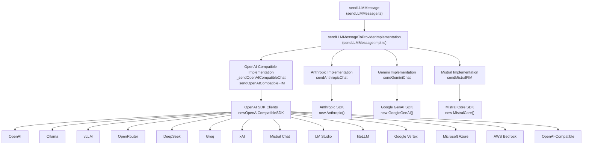

**Sources:** [src/vs/workbench/contrib/void/electron-main/llmMessage/sendLLMMessage.impl.ts:1-967]()

---

## Provider Implementation Map

The `sendLLMMessageToProviderImplementation` object maps each provider name to its implementation functions:

| Provider | Implementation Type | sendChat Function | sendFIM Function |
|----------|-------------------|-------------------|------------------|
| `openAI` | OpenAI-compatible | `_sendOpenAICompatibleChat` | `_sendOpenAICompatibleFIM` |
| `anthropic` | Native | `sendAnthropicChat` | — |
| `gemini` | Native | `sendGeminiChat` | — |
| `ollama` | OpenAI-compatible (+ FIM) | `_sendOpenAICompatibleChat` | `sendOllamaFIM` |
| `vLLM` | OpenAI-compatible | `_sendOpenAICompatibleChat` | `_sendOpenAICompatibleFIM` |
| `openRouter` | OpenAI-compatible | `_sendOpenAICompatibleChat` | — |
| `deepseek` | OpenAI-compatible | `_sendOpenAICompatibleChat` | `_sendOpenAICompatibleFIM` |
| `groq` | OpenAI-compatible | `_sendOpenAICompatibleChat` | — |
| `xAI` | OpenAI-compatible | `_sendOpenAICompatibleChat` | — |
| `mistral` | Mixed | `_sendOpenAICompatibleChat` | `sendMistralFIM` |
| `lmStudio` | OpenAI-compatible | `_sendOpenAICompatibleChat` | `_sendOpenAICompatibleFIM` |
| `liteLLM` | OpenAI-compatible | `_sendOpenAICompatibleChat` | `_sendOpenAICompatibleFIM` |
| `openAICompatible` | OpenAI-compatible | `_sendOpenAICompatibleChat` | `_sendOpenAICompatibleFIM` |
| `googleVertex` | OpenAI-compatible | `_sendOpenAICompatibleChat` | — |
| `microsoftAzure` | OpenAI-compatible | `_sendOpenAICompatibleChat` | — |
| `awsBedrock` | OpenAI-compatible (via proxy) | `_sendOpenAICompatibleChat` | — |

**Sources:** [src/vs/workbench/contrib/void/electron-main/llmMessage/sendLLMMessage.impl.ts:967]()

---

## OpenAI-Compatible Implementation

### SDK Client Creation

The `newOpenAICompatibleSDK` function creates OpenAI SDK instances configured for each provider:

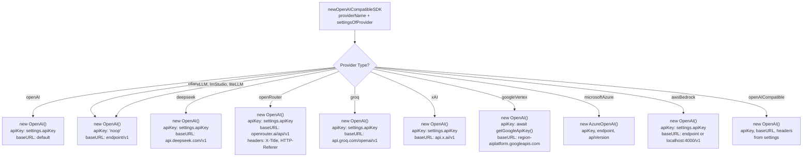

**Key implementation details:**

- **Local providers** (Ollama, vLLM, LM Studio, liteLLM) use `apiKey: 'noop'` since authentication is typically disabled [src/vs/workbench/contrib/void/electron-main/llmMessage/sendLLMMessage.impl.ts:77-90]().
- **Google Vertex** requires OAuth2 token generation via `getGoogleApiKey()` using `GoogleAuth` from `google-auth-library` [src/vs/workbench/contrib/void/electron-main/llmMessage/sendLLMMessage.impl.ts:110-123]().
- **AWS Bedrock** connects via proxy (LiteLLM or Bedrock-Access-Gateway) since the native Bedrock endpoint is not OpenAI-compatible [src/vs/workbench/contrib/void/electron-main/llmMessage/sendLLMMessage.impl.ts:125-146]().
- **OpenRouter** includes custom headers for app identification and ranking [src/vs/workbench/contrib/void/electron-main/llmMessage/sendLLMMessage.impl.ts:92-99]().
- **Custom headers** for OpenAI-Compatible are parsed from JSON via `parseHeadersJSON()` [src/vs/workbench/contrib/void/electron-main/llmMessage/sendLLMMessage.impl.ts:161-167]().

**Sources:** [src/vs/workbench/contrib/void/electron-main/llmMessage/sendLLMMessage.impl.ts:72-172]()

### Chat Message Streaming

The `_sendOpenAICompatibleChat` function handles streaming chat completions:

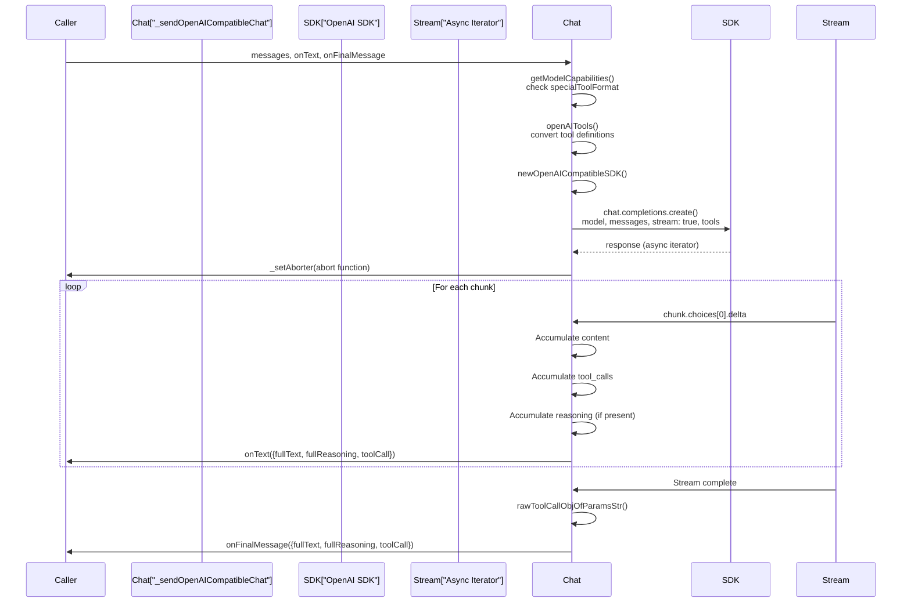

**Tool Call Handling:**
- Tools are converted via `toOpenAICompatibleTool()` which transforms `InternalToolInfo` to OpenAI's function calling format [src/vs/workbench/contrib/void/electron-main/llmMessage/sendLLMMessage.impl.ts:211-231]().
- Tool calls stream incrementally: `function?.name`, `function?.arguments`, and `id` are accumulated [src/vs/workbench/contrib/void/electron-main/llmMessage/sendLLMMessage.impl.ts:333-356]().
- Final tool parameters are parsed from JSON string via `rawToolCallObjOfParamsStr()` [src/vs/workbench/contrib/void/electron-main/llmMessage/sendLLMMessage.impl.ts:233-252]().

**Reasoning Extraction:**
- Open-source models using `<think>` tags: manually parsed via `extractReasoningWrapper()` [src/vs/workbench/contrib/void/electron-main/llmMessage/sendLLMMessage.impl.ts:254-271]().
- DeepSeek models: reasoning in `delta.reasoning_content` field [src/vs/workbench/contrib/void/electron-main/llmMessage/sendLLMMessage.impl.ts:327-328]().
- OpenAI-style models: reasoning effort passed via `reasoning_effort` parameter [src/vs/workbench/contrib/void/electron-main/llmMessage/sendLLMMessage.impl.ts:303]().

**Sources:** [src/vs/workbench/contrib/void/electron-main/llmMessage/sendLLMMessage.impl.ts:273-388]()

### FIM (Fill-In-Middle) Completions

The `_sendOpenAICompatibleFIM` function handles autocomplete requests:

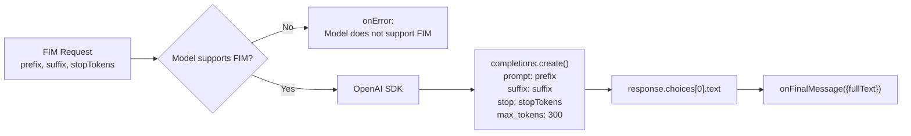

**Important notes:**
- Uses the **completions** endpoint, not chat completions [src/vs/workbench/contrib/void/electron-main/llmMessage/sendLLMMessage.impl.ts:193-200]().
- `supportsFIM` capability must be `true` in model capabilities [src/vs/workbench/contrib/void/electron-main/llmMessage/sendLLMMessage.impl.ts:177-189]().
- Non-streaming response (simpler than chat) [src/vs/workbench/contrib/void/electron-main/llmMessage/sendLLMMessage.impl.ts:202-205]().
- Fixed `max_tokens: 300` for autocomplete [src/vs/workbench/contrib/void/electron-main/llmMessage/sendLLMMessage.impl.ts:197]().

**Sources:** [src/vs/workbench/contrib/void/electron-main/llmMessage/sendLLMMessage.impl.ts:175-208]()

---

## Native Provider Implementations

### Anthropic Implementation

Anthropic uses a native streaming API via the `@anthropic-ai/sdk` package:

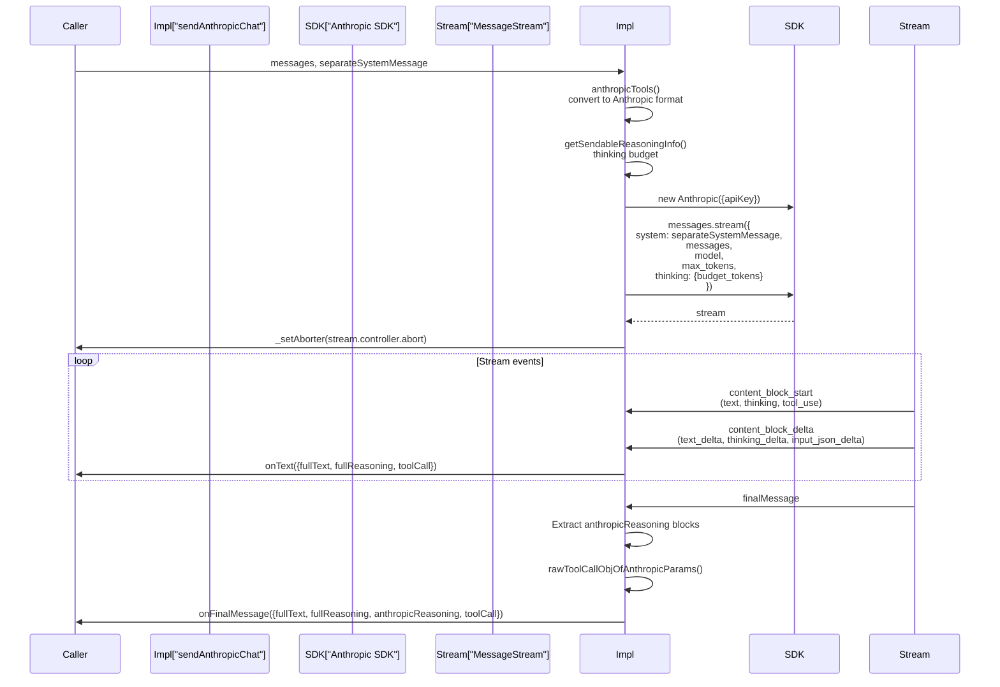

**Anthropic-Specific Features:**

1. **Separated System Message:** Uses the `system` parameter instead of a message with role `system` [src/vs/workbench/contrib/void/electron-main/llmMessage/sendLLMMessage.impl.ts:503]().
2. **Thinking Budget:** Reasoning capability controlled via `thinking: { type: 'enabled', budget_tokens: N }` [src/vs/workbench/contrib/void/electron-main/llmMessage/sendLLMMessage.impl.ts:494-500]().
3. **Tool Format:** Uses `anthropic-style` tools via `toAnthropicTool()` converter [src/vs/workbench/contrib/void/electron-main/llmMessage/sendLLMMessage.impl.ts:429-442]().
4. **Content Blocks:** Supports multiple content blocks (text, thinking, redacted_thinking, tool_use) [src/vs/workbench/contrib/void/electron-main/llmMessage/sendLLMMessage.impl.ts:515-561]().
5. **Reasoning Output:** Returns structured `anthropicReasoning` array with thinking/redacted_thinking blocks [src/vs/workbench/contrib/void/electron-main/llmMessage/sendLLMMessage.impl.ts:566]().

**Sources:** [src/vs/workbench/contrib/void/electron-main/llmMessage/sendLLMMessage.impl.ts:458-579]()

### Gemini Implementation

Gemini uses Google's native `@google/genai` SDK:

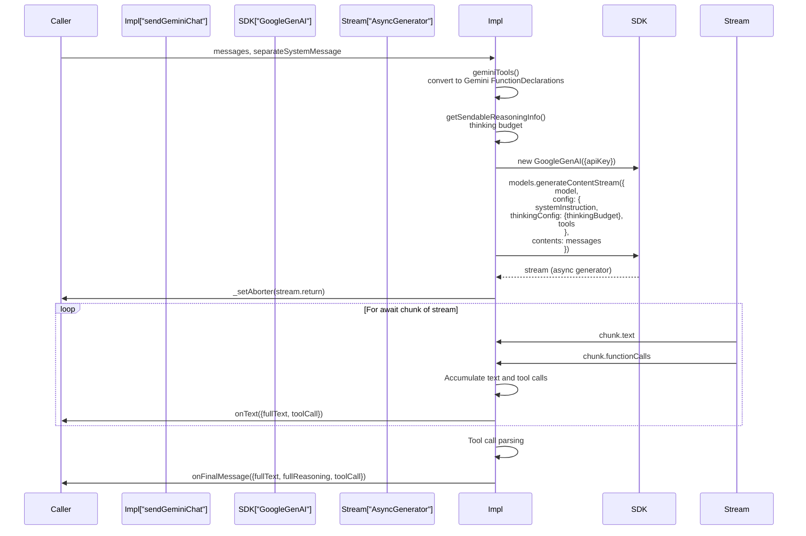

**Gemini-Specific Features:**

1. **System Instruction:** Uses `config.systemInstruction` for separated system messages [src/vs/workbench/contrib/void/electron-main/llmMessage/sendLLMMessage.impl.ts:776]().
2. **Thinking Config:** Reasoning budget via `thinkingConfig: { thinkingBudget: N }` [src/vs/workbench/contrib/void/electron-main/llmMessage/sendLLMMessage.impl.ts:777]().
3. **Tool Format:** Uses `gemini-style` with `FunctionDeclaration` objects via `toGeminiFunctionDecl()` [src/vs/workbench/contrib/void/electron-main/llmMessage/sendLLMMessage.impl.ts:685-701]().
4. **Function Calls:** Tools streamed as `chunk.functionCalls` array with `name`, `args`, and `id` [src/vs/workbench/contrib/void/electron-main/llmMessage/sendLLMMessage.impl.ts:805-816]().
5. **Async Generator:** Stream is a standard async generator (not event-based like Anthropic) [src/vs/workbench/contrib/void/electron-main/llmMessage/sendLLMMessage.impl.ts:797-832]().

**Sources:** [src/vs/workbench/contrib/void/electron-main/llmMessage/sendLLMMessage.impl.ts:717-850]()

---

## Provider-Specific Details

### Ollama

Ollama has both OpenAI-compatible chat and native FIM implementations:

**Chat:** Uses OpenAI-compatible implementation with special endpoint handling [src/vs/workbench/contrib/void/electron-main/llmMessage/sendLLMMessage.impl.ts:967]().
**FIM:** Native implementation using Ollama SDK's `generate()` method with `raw: true` mode [src/vs/workbench/contrib/void/electron-main/llmMessage/sendLLMMessage.impl.ts:652-681]().

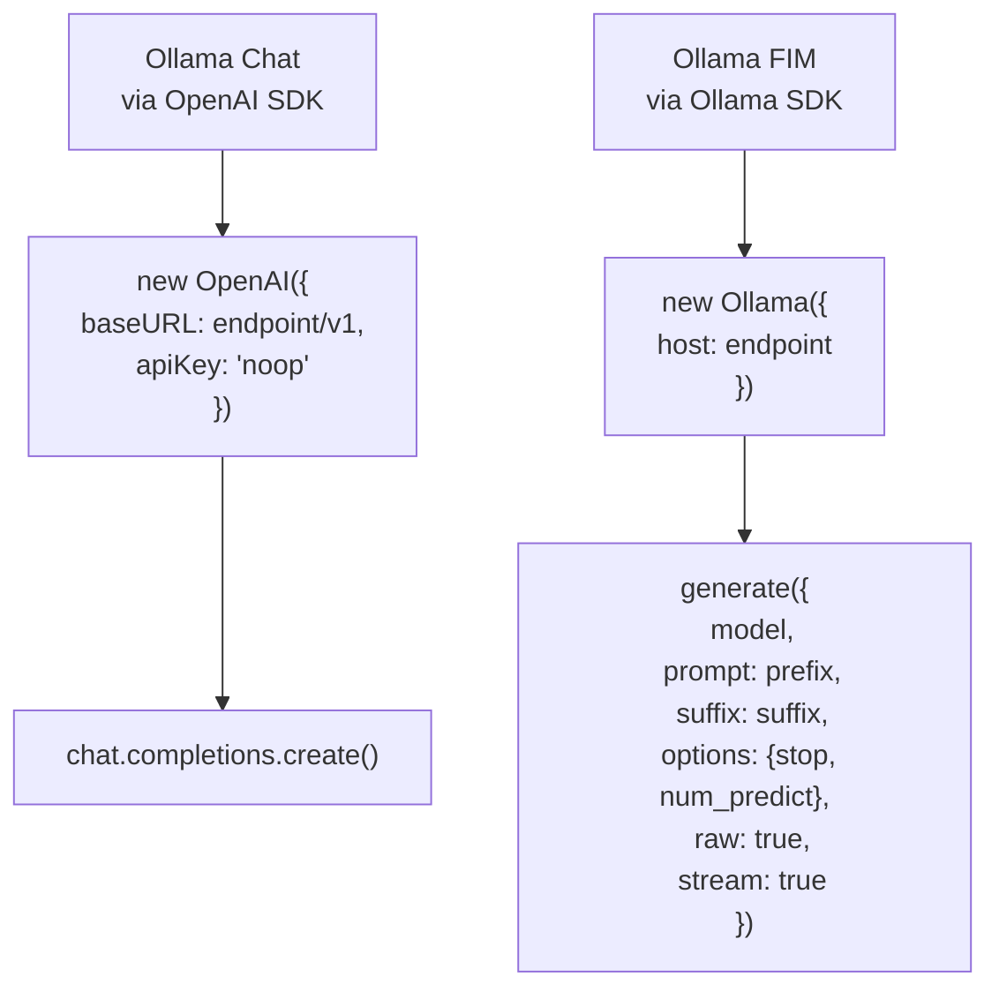

**Ollama-specific details:**
- Endpoint validation: throws error if endpoint is empty [src/vs/workbench/contrib/void/electron-main/llmMessage/sendLLMMessage.impl.ts:623-625]().
- Model listing via `ollama.list()` for auto-detection [src/vs/workbench/contrib/void/electron-main/llmMessage/sendLLMMessage.impl.ts:634]().
- FIM uses `raw: true` to bypass prompt templates [src/vs/workbench/contrib/void/electron-main/llmMessage/sendLLMMessage.impl.ts:664]().
- Streaming FIM exposes `abort()` function for cancellation [src/vs/workbench/contrib/void/electron-main/llmMessage/sendLLMMessage.impl.ts:673]().

**Sources:** [src/vs/workbench/contrib/void/electron-main/llmMessage/sendLLMMessage.impl.ts:621-681]()

### Mistral

Mistral has separate implementations for chat (OpenAI-compatible) and FIM (native):

**FIM Implementation:**
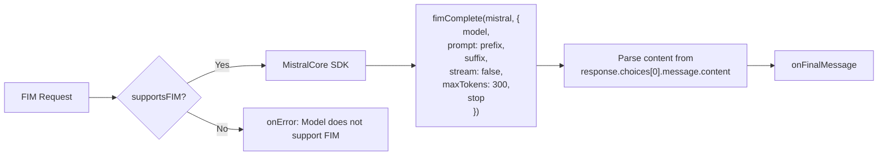

**Notes:**
- Uses `@mistralai/mistralai/core.js` and `@mistralai/mistralai/funcs/fimComplete.js` [src/vs/workbench/contrib/void/electron-main/llmMessage/sendLLMMessage.impl.ts:599-606]().
- Non-streaming FIM (unlike Ollama) [src/vs/workbench/contrib/void/electron-main/llmMessage/sendLLMMessage.impl.ts:602]().
- Content can be string or array of chunks [src/vs/workbench/contrib/void/electron-main/llmMessage/sendLLMMessage.impl.ts:608-612]().

**Sources:** [src/vs/workbench/contrib/void/electron-main/llmMessage/sendLLMMessage.impl.ts:585-617]()

### AWS Bedrock

AWS Bedrock requires a proxy for OpenAI compatibility:

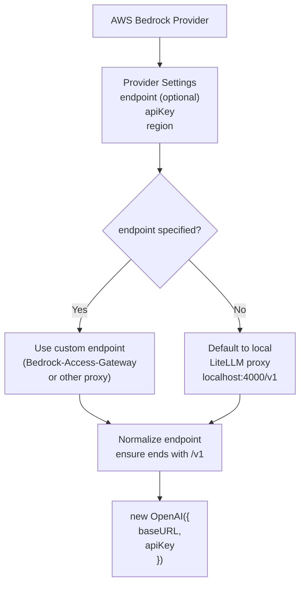

**AWS Bedrock Notes:**
- Native Bedrock runtime endpoint is **NOT** OpenAI-compatible.
- Requires proxy setup (LiteLLM or Bedrock-Access-Gateway) [src/vs/workbench/contrib/void/electron-main/llmMessage/sendLLMMessage.impl.ts:125-146]().
- If no endpoint specified, defaults to `http://localhost:4000/v1` (local LiteLLM) [src/vs/workbench/contrib/void/electron-main/llmMessage/sendLLMMessage.impl.ts:133]().
- Endpoint normalization ensures path ends with `/v1` [src/vs/workbench/contrib/void/electron-main/llmMessage/sendLLMMessage.impl.ts:139-142]().

**Sources:** [src/vs/workbench/contrib/void/electron-main/llmMessage/sendLLMMessage.impl.ts:125-146]()

---

## Tool Format Conversion

Different providers use different tool calling formats. Void converts from `InternalToolInfo` to provider-specific formats:

### OpenAI-Style Tools

```typescript
// toOpenAICompatibleTool()
{
  type: 'function',
  function: {
    name: string,
    description: string,
    parameters: {
      type: 'object',
      properties: {
        [key: string]: {
          description: string,
          type: 'string'
        }
      }
    }
  }
}
```

**Sources:** [src/vs/workbench/contrib/void/electron-main/llmMessage/sendLLMMessage.impl.ts:211-231]()

### Anthropic-Style Tools

```typescript
// toAnthropicTool()
{
  name: string,
  description: string,
  input_schema: {
    type: 'object',
    properties: {
      [key: string]: {
        description: string,
        type: 'string'
      }
    }
  }
}
```

**Sources:** [src/vs/workbench/contrib/void/electron-main/llmMessage/sendLLMMessage.impl.ts:429-442]()

### Gemini-Style Tools

```typescript
// toGeminiFunctionDecl()
{
  name: string,
  description: string,
  parameters: {
    type: Type.OBJECT,
    properties: {
      [key: string]: {
        type: Type.STRING,
        description: string
      }
    }
  }
}
```

**Sources:** [src/vs/workbench/contrib/void/electron-main/llmMessage/sendLLMMessage.impl.ts:685-701]()

---

## Model Listing and Auto-Detection

Void auto-detects available models for local providers:

### OpenAI-Compatible Listing

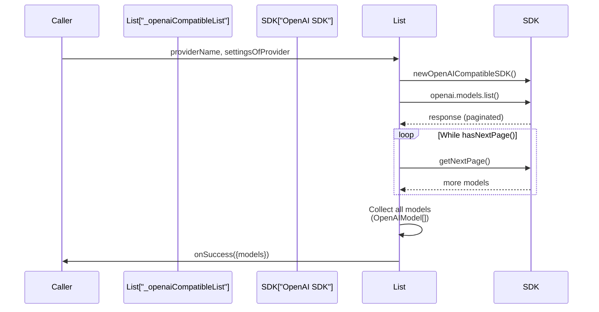

**Sources:** [src/vs/workbench/contrib/void/electron-main/llmMessage/sendLLMMessage.impl.ts:392-423]()

### Ollama Listing

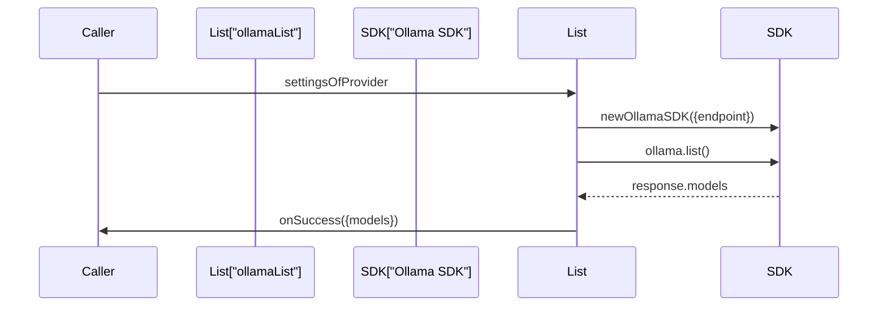

**Sources:** [src/vs/workbench/contrib/void/electron-main/llmMessage/sendLLMMessage.impl.ts:628-650]()

---

## Error Handling Patterns

### API Key Validation

All implementations check for 401 errors and convert to user-friendly messages:

```typescript
// OpenAI-compatible
.catch(error => {
  if (error instanceof OpenAI.APIError && error.status === 401) {
    onError({ message: invalidApiKeyMessage(providerName), fullError: error });
  }
  else {
    onError({ message: error + '', fullError: error });
  }
})
```

**Sources:** [src/vs/workbench/contrib/void/electron-main/llmMessage/sendLLMMessage.impl.ts:384-387](), [src/vs/workbench/contrib/void/electron-main/llmMessage/sendLLMMessage.impl.ts:574-577]()

### Model Capability Checks

FIM implementations verify model support before execution:

```typescript
const { supportsFIM } = getModelCapabilities(providerName, modelName, overridesOfModel)

if (!supportsFIM) {
  // ... trigger onError
}
```

**Sources:** [src/vs/workbench/contrib/void/electron-main/llmMessage/sendLLMMessage.impl.ts:177-189]()

---

## Provider Settings Structure

Each provider has specific settings defined in `defaultProviderSettings`:

| Provider | Settings Fields |
|----------|----------------|
| `openAI` | `apiKey` |
| `anthropic` | `apiKey` |
| `gemini` | `apiKey` |
| `deepseek` | `apiKey` |
| `ollama` | `endpoint` |
| `vLLM` | `endpoint` |
| `lmStudio` | `endpoint` |
| `liteLLM` | `endpoint` |
| `openRouter` | `apiKey` |
| `groq` | `apiKey` |
| `xAI` | `apiKey` |
| `mistral` | `apiKey` |
| `openAICompatible` | `endpoint`, `apiKey`, `headersJSON` |
| `googleVertex` | `region`, `project` |
| `microsoftAzure` | `project`, `apiKey`, `azureApiVersion` |
| `awsBedrock` | `apiKey`, `region`, `endpoint` |

**Sources:** [src/vs/workbench/contrib/void/common/modelCapabilities.ts:12-68]()