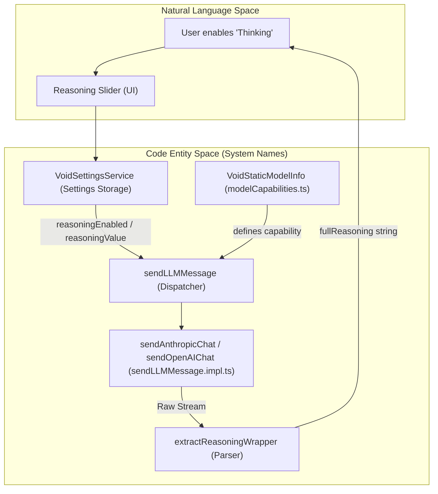
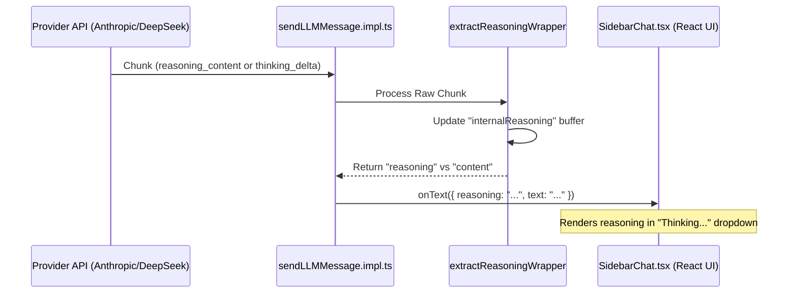

# Reasoning and Extended Thinking

Relevant source files

The following files were used as context for generating this wiki page:

- [.voidrules](.voidrules)

## Purpose and Scope

This document describes the **reasoning and extended thinking capabilities** in the Void editor. It details how Void manages advanced LLM features such as explicit reasoning chains, "thinking budgets," effort sliders, and the parsing of reasoning tokens from model streams.

The reasoning system is designed to be provider-agnostic at the interface level while providing deep integration for specific implementations like Anthropic's `thinking` blocks, OpenAI's `reasoning_effort`, and open-source `']`) for parsing in-band reasoning. [src/vs/workbench/contrib/void/common/modelCapabilities.ts:186-187]() |

**Sources:**
- `VoidStaticModelInfo` definition: [src/vs/workbench/contrib/void/common/modelCapabilities.ts:162-203]()

---

## 2. Implementation Logic and Provider Support

Reasoning logic is split between static configuration in `modelCapabilities.ts` and runtime execution in `sendLLMMessage.impl.ts`.

### Diagram: Reasoning Configuration to Execution Flow
This diagram maps the high-level concept of "Reasoning" to the specific code entities that handle data flow.

**Sources:**
- `VoidSettingsService` usage: [src/vs/workbench/contrib/void/browser/voidSettingsService.ts:10-20]()
- `sendLLMMessage` dispatch: [src/vs/workbench/contrib/void/electron-main/llmMessage/sendLLMMessage.ts:50-100]()
- Provider implementations: [src/vs/workbench/contrib/void/electron-main/llmMessage/sendLLMMessage.impl.ts:1-967]()

---

## 3. Provider-Specific Reasoning Mechanisms

### Anthropic (Claude 3.7+)
Anthropic uses a "Thinking Budget." Void implements this by adding a `thinking` object to the request payload if enabled.
- **Payload**: Includes `type: 'enabled'` and `budget_tokens`. [src/vs/workbench/contrib/void/electron-main/llmMessage/sendLLMMessage.impl.ts:469-493]()
- **Response**: Handled via `thinking_delta` and `signature` blocks in the stream. [src/vs/workbench/contrib/void/electron-main/llmMessage/sendLLMMessage.impl.ts:520-572]()

### OpenAI (o1, o3-mini)
OpenAI uses a qualitative "Reasoning Effort."
- **Payload**: The `reasoning_effort` parameter is set to `low`, `medium`, or `high`. [src/vs/workbench/contrib/void/electron-main/llmMessage/sendLLMMessage.impl.ts:284-290]()
- **Note**: As of current implementation, OpenAI does not stream reasoning tokens to the client; reasoning is internal. [src/vs/workbench/contrib/void/common/modelCapabilities.ts:707-714]()

### DeepSeek and Open Source
DeepSeek and models like Llama-3-Thinking often use explicit tags or specific delta fields.
- **DeepSeek**: Uses a `reasoning_content` field in the streaming delta. [src/vs/workbench/contrib/void/common/modelCapabilities.ts:950-953]()
- **Ollama/OpenSource**: Void uses `extractReasoningWrapper` to look for tags like `` within the standard content stream. [src/vs/workbench/contrib/void/electron-main/llmMessage/sendLLMMessage.impl.ts:316-319]()

---

## 4. The Reasoning Output Pipeline

When reasoning is enabled, the `onText` callback in `sendLLMMessage` provides two distinct strings: the standard `text` and the `fullReasoning`.

### Diagram: Streaming Data Flow (Natural Language to Code)
This diagram shows how raw provider data is converted into structured UI updates.

**Sources:**
- `onText` signature: [src/vs/workbench/contrib/void/common/llmMessageService.ts:35-45]()
- Reasoning wrapper logic: [src/vs/workbench/contrib/void/electron-main/llmMessage/sendLLMMessage.impl.ts:316-340]()
- UI state management: [src/vs/workbench/contrib/void/browser/chatThreadService.ts:200-250]()

---

## 5. UI Controls: getIsReasoningEnabledState

The visibility and state of reasoning controls are managed by `VoidSettingsService`. The UI queries whether a model supports reasoning before rendering the sliders.

- **Settings Integration**: The reasoning toggle and slider values are stored per-provider and per-feature (Chat, Autocomplete, etc.). [src/vs/workbench/contrib/void/browser/voidSettingsService.ts:115-130]()
- **Model Detection**: The `supportsReasoning` flag in `VoidStaticModelInfo` is the source of truth for showing the "Reasoning" button in the chat input bar. [src/vs/workbench/contrib/void/common/modelCapabilities.ts:176-176]()

### Reasoning Slider Types
1. **Budget Slider**: Configures `max_tokens` specifically for the thinking process. Used by Anthropic. [src/vs/workbench/contrib/void/common/modelCapabilities.ts:180-182]()
2. **Effort Slider**: Configures qualitative depth. Used by OpenAI and DeepSeek. [src/vs/workbench/contrib/void/common/modelCapabilities.ts:183-185]()

**Sources:**
- Slider definitions: [src/vs/workbench/contrib/void/common/modelCapabilities.ts:180-185]()
- Anthropic capability setup: [src/vs/workbench/contrib/void/common/modelCapabilities.ts:573-583]()
- OpenAI capability setup: [src/vs/workbench/contrib/void/common/modelCapabilities.ts:707-714]()
- DeepSeek capability setup: [src/vs/workbench/contrib/void/common/modelCapabilities.ts:950-953]()