# Message Format Conversion

<details>
<summary>Relevant source files</summary>

The following files were used as context for generating this wiki page:

- [.voidrules](.voidrules)

</details>


This page documents the message conversion pipeline that transforms Void's internal message format into provider-specific formats required by different LLM APIs (OpenAI, Anthropic, Gemini, etc.). The conversion handles role mapping, tool call formatting, reasoning/thinking support, system message placement, and context window management.

For information about how converted messages are sent to providers, see [LLM Message Pipeline and Dispatch](#4.1). For provider-specific implementations, see [Provider Implementations](#4.2).

---

## Conversion Pipeline Overview

The conversion pipeline transforms internal chat history into provider-specific formats before transmission to LLM APIs.

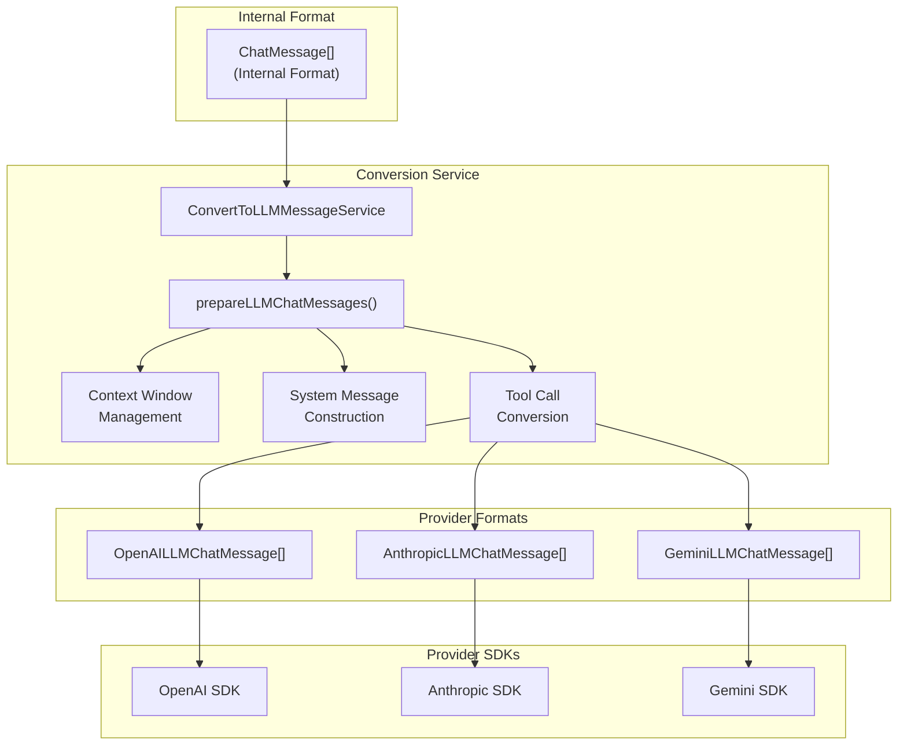

**Sources:** [src/vs/workbench/contrib/void/browser/convertToLLMMessageService.ts:1-768](), [src/vs/workbench/contrib/void/browser/chatThreadService.ts:732-832]()

---

## Internal Message Format

Void uses a unified internal message format (`ChatMessage`) that represents the chat history independently of any specific provider.

### ChatMessage Type Structure

| Role | Purpose | Key Fields |
|------|---------|-----------|
| `user` | User input messages | `content`, `displayContent`, `selections` |
| `assistant` | LLM responses | `displayContent`, `reasoning`, `anthropicReasoning` |
| `tool` | Tool call results | `name`, `params`, `result`, `type`, `rawParams` |
| `checkpoint` | File state snapshots | `voidFileSnapshotOfURI` |
| `interrupted_streaming_tool` | Canceled tool calls | `name`, `mcpServerName` |

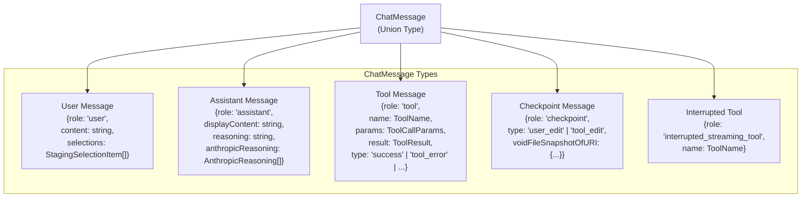

**Sources:** [src/vs/workbench/contrib/void/common/chatThreadServiceTypes.ts:50-82]()

---

## Provider-Specific Message Formats

Different providers require different message structures. The conversion service transforms the internal format into one of three provider-specific formats.

### Format Comparison

| Feature | OpenAI Format | Anthropic Format | Gemini Format |
|---------|---------------|------------------|---------------|
| **System Message** | `role: 'system'` or `'developer'` | Separate `system` parameter | In first user message |
| **Assistant Role** | `role: 'assistant'` | `role: 'assistant'` | `role: 'model'` |
| **Tool Calls** | `tool_calls` array | `content` array with `tool_use` | `parts` array with `functionCall` |
| **Tool Results** | `role: 'tool'` | `content` array with `tool_result` | `parts` array with `functionResponse` |
| **Reasoning** | Not supported natively | `thinking` content blocks | Not supported natively |

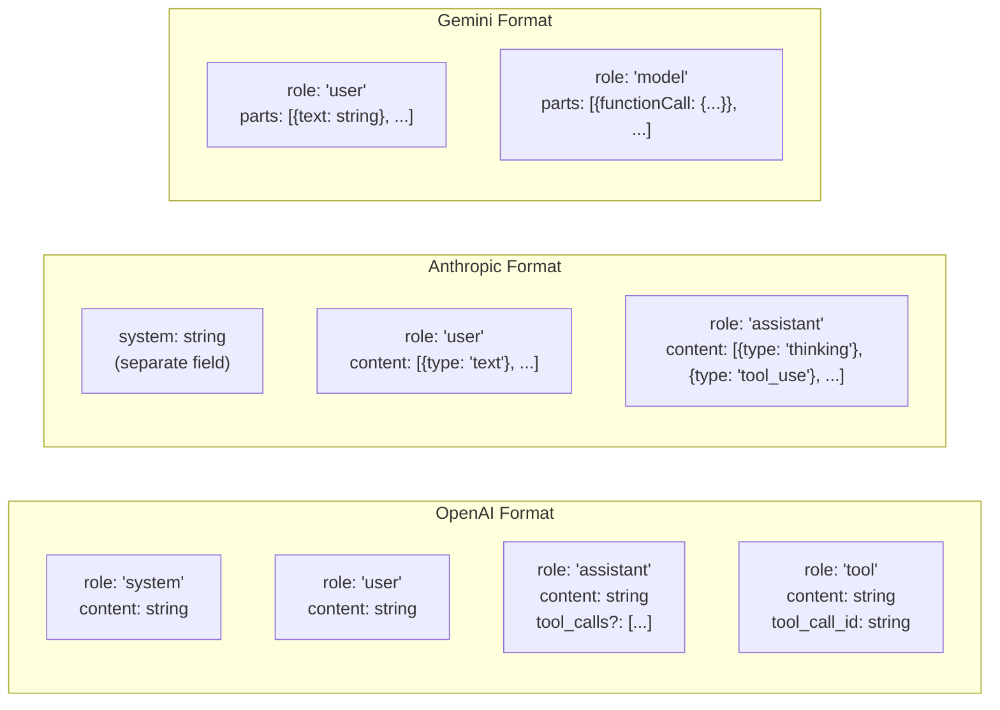

**Sources:** [src/vs/workbench/contrib/void/common/sendLLMMessageTypes.ts:32-78](), [src/vs/workbench/contrib/void/browser/convertToLLMMessageService.ts:143-768]()

---

## ConvertToLLMMessageService

The `ConvertToLLMMessageService` is the central conversion engine. It provides two main conversion methods.

### Service Interface

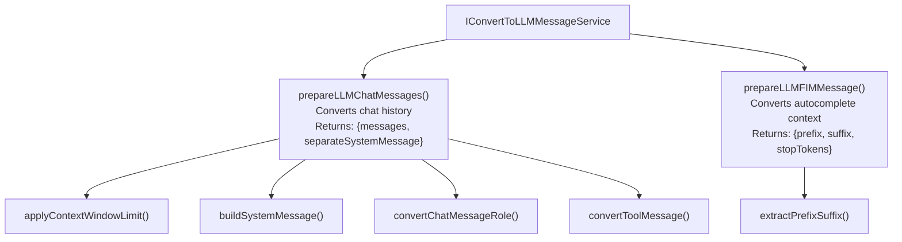

### prepareLLMChatMessages Method

The main conversion method follows this pipeline:

1. **Filter Internal Messages**: Remove checkpoints, keep only user/assistant/tool messages
2. **Build System Message**: Construct system message with workspace context
3. **Convert Message Roles**: Transform internal roles to provider-specific roles
4. **Convert Tool Messages**: Format tool calls and results for the provider
5. **Apply Context Window**: Trim messages to fit within model's context window
6. **Separate System Message**: Extract system message if provider requires it

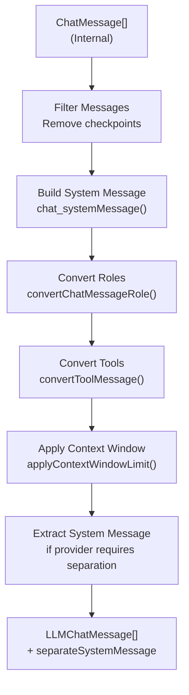

**Sources:** [src/vs/workbench/contrib/void/browser/convertToLLMMessageService.ts:143-330]()

---

## Message Role Conversion

The service converts internal message roles to provider-specific roles based on model capabilities.

### Role Mapping Logic

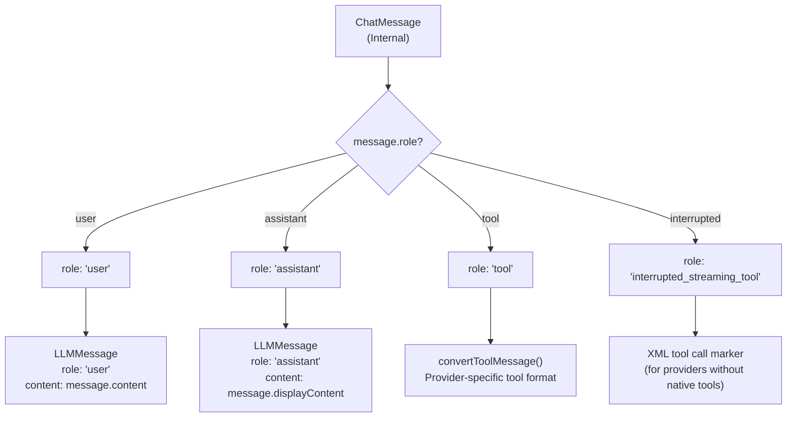

### User Message Conversion

User messages include selections (attached files) in their content:

```
User message content:
{user's actual message}

SELECTIONS
file1.ts
file2.ts
{file contents...}
```

**Sources:** [src/vs/workbench/contrib/void/browser/convertToLLMMessageService.ts:445-519](), [src/vs/workbench/contrib/void/browser/convertToLLMMessageService.ts:587-666]()

---

## Tool Call Conversion

Tool calls and results are formatted differently for each provider. The conversion handles three provider tool formats: OpenAI-style, Anthropic-style, and Gemini-style.

### Tool Conversion Pipeline

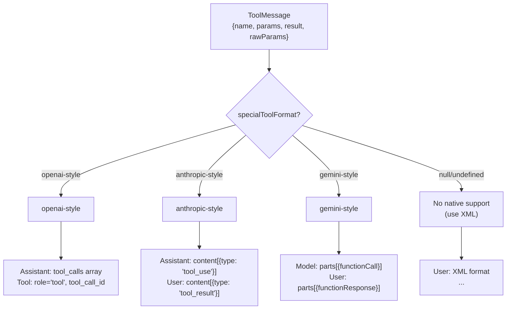

### OpenAI Tool Format

For providers using OpenAI-style tools:

**Tool Call (Assistant Message)**:
```typescript
{
  role: 'assistant',
  content: '',
  tool_calls: [{
    type: 'function',
    id: 'call_123',
    function: {
      name: 'read_file',
      arguments: '{"uri":"/path/to/file","page_number":1}'
    }
  }]
}
```

**Tool Result (Tool Message)**:
```typescript
{
  role: 'tool',
  content: '<file contents>',
  tool_call_id: 'call_123'
}
```

### Anthropic Tool Format

For Anthropic:

**Tool Call (Assistant Message)**:
```typescript
{
  role: 'assistant',
  content: [{
    type: 'tool_use',
    id: 'toolu_123',
    name: 'read_file',
    input: {
      uri: '/path/to/file',
      page_number: 1
    }
  }]
}
```

**Tool Result (User Message)**:
```typescript
{
  role: 'user',
  content: [{
    type: 'tool_result',
    tool_use_id: 'toolu_123',
    content: '<file contents>'
  }]
}
```

### Gemini Tool Format

For Gemini:

**Tool Call (Model Message)**:
```typescript
{
  role: 'model',
  parts: [{
    functionCall: {
      id: 'call_123',
      name: 'read_file',
      args: {
        uri: '/path/to/file',
        page_number: 1
      }
    }
  }]
}
```

**Tool Result (User Message)**:
```typescript
{
  role: 'user',
  parts: [{
    functionResponse: {
      id: 'call_123',
      name: 'read_file',
      response: {
        output: '<file contents>'
      }
    }
  }]
}
```

**Sources:** [src/vs/workbench/contrib/void/browser/convertToLLMMessageService.ts:333-442](), [src/vs/workbench/contrib/void/electron-main/llmMessage/sendLLMMessage.impl.ts:210-267]()

---

## System Message Construction

The system message provides context about the workspace, available tools, and instructions. Its placement varies by provider.

### System Message Components

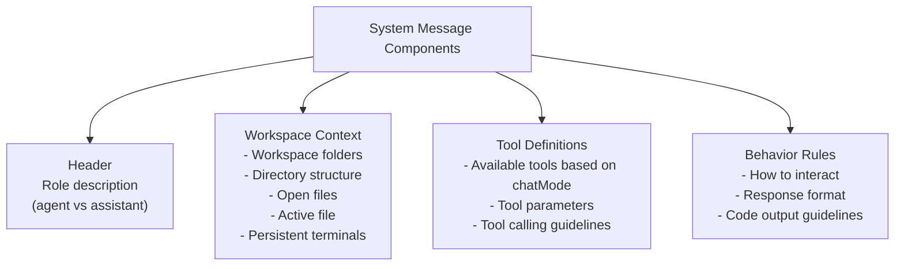

### System Message Placement by Provider

| Provider | Placement Method | Implementation |
|----------|------------------|----------------|
| **OpenAI** | `role: 'system'` or `role: 'developer'` | First message in array |
| **Anthropic** | Separate `system` parameter | Returned as `separateSystemMessage` |
| **Gemini** | Prepended to first user message | Merged into first user message |
| **Ollama/vLLM** | `role: 'system'` | First message in array |

The `supportsSystemMessage` capability determines placement:
- `'system-role'`: Add as `role: 'system'` message
- `'developer-role'`: Add as `role: 'developer'` message (OpenAI reasoning models)
- `'separated'`: Return as separate parameter (Anthropic)
- `false`: Prepend to first user message (Gemini)

**Sources:** [src/vs/workbench/contrib/void/common/prompt/prompts.ts:428-574](), [src/vs/workbench/contrib/void/browser/convertToLLMMessageService.ts:521-585](), [src/vs/workbench/contrib/void/common/modelCapabilities.ts:169-170]()

---

## Context Window Management

The conversion service ensures messages fit within the model's context window by trimming older messages when necessary.

### Context Window Calculation

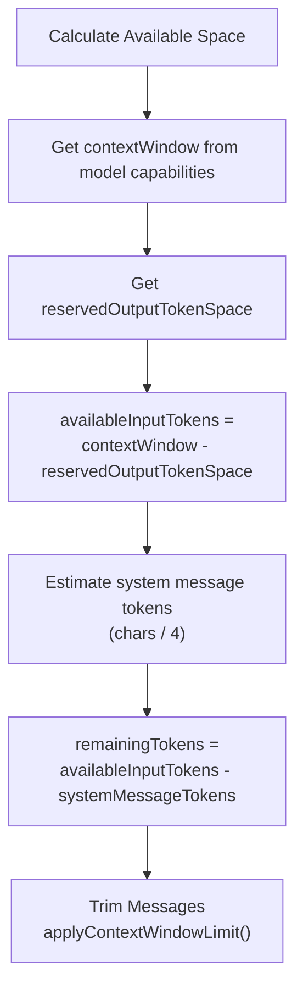

### Message Trimming Algorithm

The `applyContextWindowLimit` function trims messages from the beginning of the conversation when the context window is exceeded:

1. **Estimate Token Usage**: Convert characters to tokens using `CHARS_PER_TOKEN = 4`
2. **Scan from End**: Iterate backwards through messages
3. **Count Tokens**: Accumulate token count for each message
4. **Find Cutoff**: Stop when remaining tokens < message tokens
5. **Trim Messages**: Remove messages before cutoff point
6. **Preserve Structure**: Keep at least the last user message

If after trimming, the system message still exceeds the limit, an error message is displayed to the user.

**Sources:** [src/vs/workbench/contrib/void/browser/convertToLLMMessageService.ts:667-755](), [src/vs/workbench/contrib/void/common/modelCapabilities.ts:162-203]()

---

## Reasoning/Thinking Conversion

Models with reasoning capabilities output "thinking" or "reasoning" content. The conversion service handles this differently for each provider.

### Reasoning Support by Provider

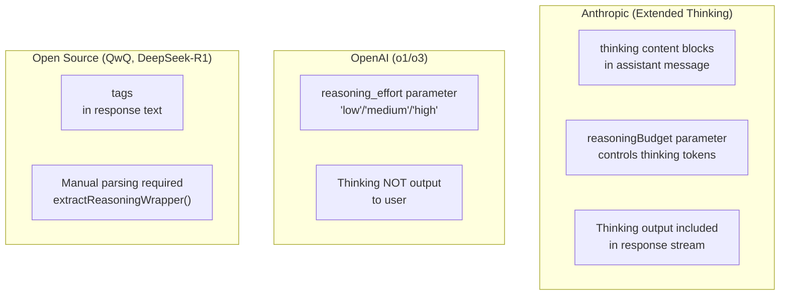

### Anthropic Reasoning Format

Anthropic's Extended Thinking uses content blocks:

**Assistant message with thinking**:
```typescript
{
  role: 'assistant',
  content: [
    {
      type: 'thinking',
      thinking: 'Let me analyze this problem...'
    },
    {
      type: 'text',
      text: 'Here is my response...'
    }
  ]
}
```

The reasoning budget is set via:
```typescript
{
  thinking: {
    type: 'enabled',
    budget_tokens: 1024
  }
}
```

### Open Source Reasoning Parsing

For open-source reasoning models (QwQ, DeepSeek-R1, Phi-4), the service manually extracts `` closing tag
4. Strip thinking from display text
5. Store thinking separately in `fullReasoningSoFar`

**Sources:** [src/vs/workbench/contrib/void/electron-main/llmMessage/extractGrammar.ts:17-106](), [src/vs/workbench/contrib/void/common/modelCapabilities.ts:176-190](), [src/vs/workbench/contrib/void/browser/convertToLLMMessageService.ts:757-768]()

---

## FIM Message Conversion

For autocomplete (Fill-In-Middle), the conversion service generates prefix/suffix context from the current editor state.

### FIM Conversion Pipeline

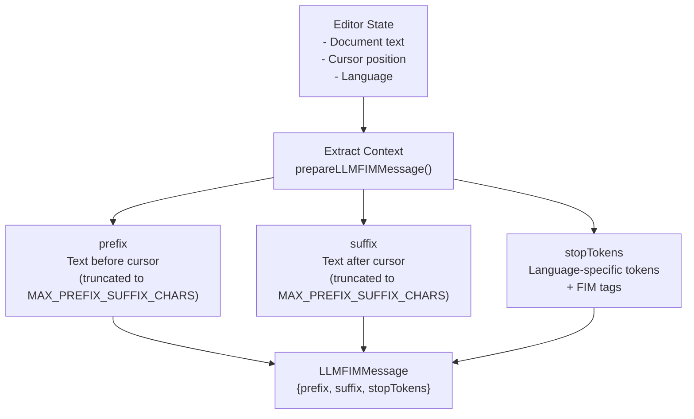

### Stop Tokens Generation

Stop tokens are generated based on:
1. **Language-specific tokens**: Common code delimiters for the current language
2. **FIM tag tokens**: Default tags like `<fim_prefix>`, `<fim_suffix>`, `<fim_middle>`
3. **Custom model tags**: Model-specific FIM tags from `defaultQuickEditFimTags`

The `MAX_PREFIX_SUFFIX_CHARS = 20_000` limit ensures the context fits within the model's window.

**Sources:** [src/vs/workbench/contrib/void/browser/convertToLLMMessageService.ts:768](), [src/vs/workbench/contrib/void/common/prompt/prompts.ts:33-35]()

---

## XML Tool Format (Fallback)

When a provider doesn't support native tool calling (`specialToolFormat` is null), the service falls back to XML-formatted tool calls embedded in text.

### XML Tool Format Structure

```
<tool_name>
<param1>value1</param1>
<param2>value2</param2>
</tool_name>
```

The system message includes XML tool definitions when native tools aren't supported:

```
Available tools:

1. read_file
Description: Returns full contents of a given file.
Format:
<read_file>
<uri>The FULL path to the file.</uri>
<page_number>Optional. The page number of the result. Default is 1.</page_number>
</read_file>

Tool calling details:
- To call a tool, write its name and parameters in XML format
- After writing the tool call, you must STOP and WAIT for the result
- All parameters are REQUIRED unless noted otherwise
```

The `extractXMLToolsWrapper` function parses XML tool calls from the LLM's text output.

**Sources:** [src/vs/workbench/contrib/void/common/prompt/prompts.ts:380-423](), [src/vs/workbench/contrib/void/electron-main/llmMessage/extractGrammar.ts:108-372]()

---

## Integration Points

The conversion service is called at these points in the codebase:

| Caller | Location | Purpose |
|--------|----------|---------|
| **ChatThreadService** | `_runChatAgent()` | Convert chat history before LLM call |
| **AutocompleteService** | `_provideFIMCompletionItems()` | Generate FIM context for autocomplete |
| **EditCodeService** | `startApplying()` | Convert messages for code edit requests |

### Typical Usage Pattern

```typescript
// In ChatThreadService._runChatAgent()
const { messages, separateSystemMessage } = await this._convertToLLMMessagesService.prepareLLMChatMessages({
  chatMessages,
  modelSelection,
  chatMode
})

// Pass to LLM dispatcher
this._llmMessageService.sendLLMMessageChat({
  messages,
  separateSystemMessage,
  // ... other params
})
```

**Sources:** [src/vs/workbench/contrib/void/browser/chatThreadService.ts:780-784](), [src/vs/workbench/contrib/void/browser/editCodeService.ts:1027-1035]()