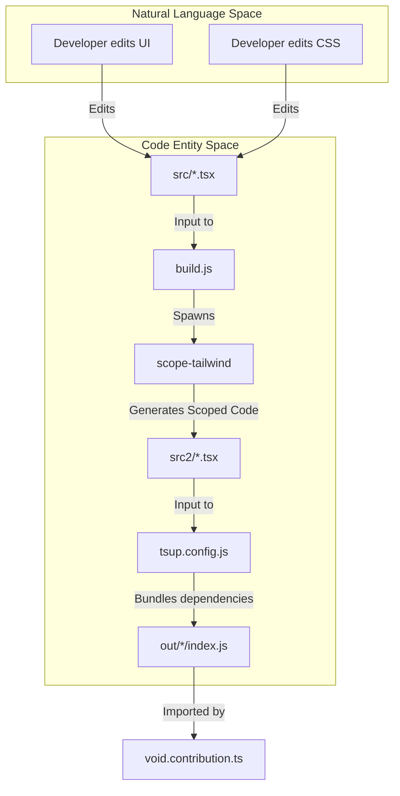
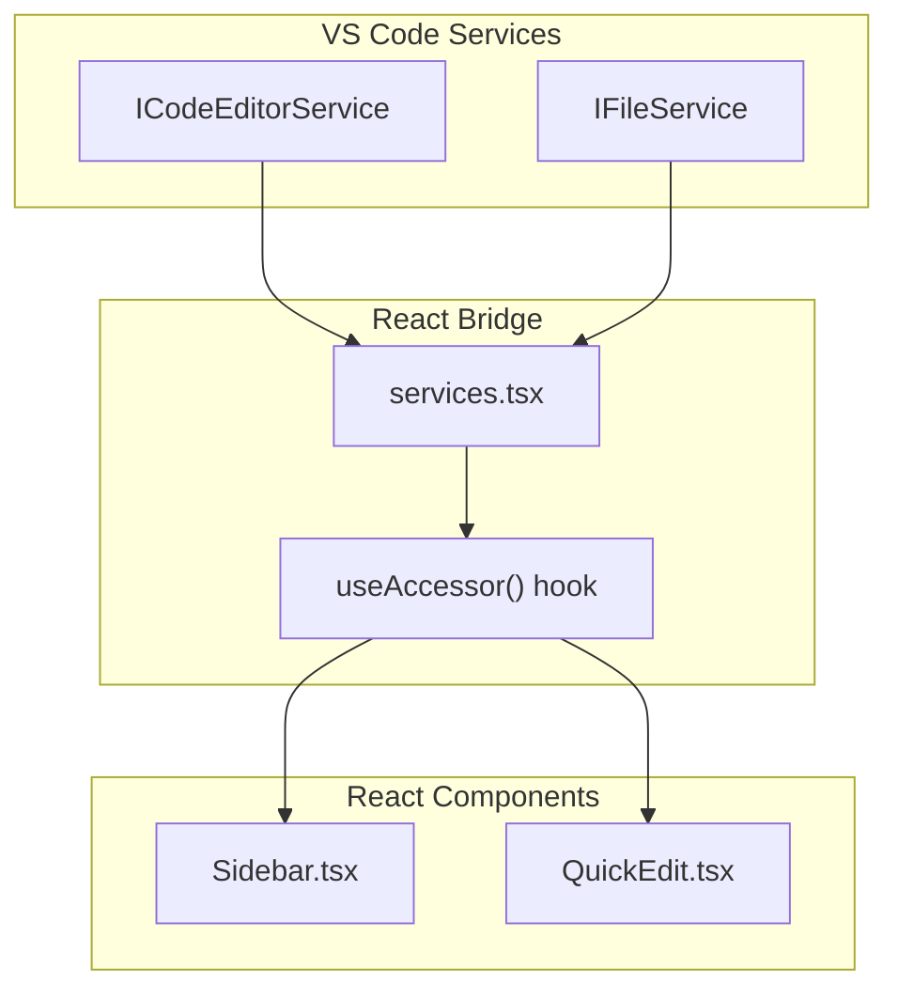

# Developer Guide

Relevant source files

The following files were used as context for generating this wiki page:

- [.configurations/configuration.dsc.yaml](.configurations/configuration.dsc.yaml)
- [.devcontainer/Dockerfile](.devcontainer/Dockerfile)
- [.devcontainer/devcontainer.json](.devcontainer/devcontainer.json)

This guide provides essential information for developers working on Void or extending it. It covers the build system, development workflow, React integration patterns, and guidelines for adding new features.

For detailed information about specific subsystems:
- **Build System and Pipeline:** Explain the two-stage React build pipeline (scope-tailwind → tsup via build.js), tsup.config.js bundling strategy, external/internal module handling, watch mode, and the broader VS Code build system. For details, see [Build System and Pipeline](#5.1).
- **React Component Architecture:** Document how React components integrate with VS Code services via `useAccessor` and state hooks in `services.tsx`, the `mountFnGenerator` pattern, and the component hierarchy. For details, see [React Component Architecture](#5.2).
- **Development Environment Setup:** Guide for setting up the development environment, prerequisites (Node.js, Python, VS Build Tools), running in dev mode, and using the devcontainer. For details, see [Development Environment Setup](#5.3).
- **VS Code Integration Patterns:** Explain how Void uses VS Code's extension APIs, service injection via `createDecorator`/`registerSingleton`, IPC channels, and contribution points. For details, see [VS Code Integration Patterns](#5.4).
- **Remote Development and Server Setup:** Document remote development capabilities via SSH/WSL and the CLI tunnel system. For details, see [Remote Development and Server Setup](#5.5).
- **Error Handling and UI Patterns:** Explain error display patterns, validation, and common UI input components. For details, see [Error Handling and UI Patterns](#5.6).

---

## Development Workflow Overview

Void's development workflow centers on a specialized build pipeline that integrates React components into VS Code's TypeScript-based architecture. The system uses a two-stage build process that transforms React source files into VS Code-compatible bundles.

### React Build Pipeline

**Sources:** [package.json:13-14](), [src/vs/workbench/contrib/void/browser/react/build.js:80-154]()

---

## Build System Architecture

The build system implements a two-stage pipeline that solves the challenge of integrating modern React development with VS Code's extension architecture.

### Stage 1: CSS Scoping with scope-tailwind
The first stage uses `scope-tailwind` to prefix all CSS classes and scope styles, preventing conflicts with VS Code's global styles. It transforms `flex` to `void-flex` and wraps everything in a `.void-scope` selector.

### Stage 2: Bundling with tsup
The second stage uses `tsup` (powered by esbuild) to bundle each React component into a standalone ESM module. It handles 7 distinct entry points including the Sidebar, Settings, and Quick Edit.

**Key tsup settings:**
- `format: ['esm']`: Output ES modules for VS Code compatibility.
- `injectStyle: true`: Bundle CSS directly into JS files.
- `noExternal: [/^(?!\.).*$/]`: Bundle all npm dependencies (React, lucide-react, etc.).
- `external: [../../../*.js]`: Keep VS Code service imports external.

**Sources:** [src/vs/workbench/contrib/void/browser/react/tsup.config.js:8-43](), [src/vs/workbench/contrib/void/browser/react/build.js:1-154]()

---

## Development Environment Setup

Void requires specific native dependencies and configurations to build the full VS Code fork.

### Prerequisites
The environment setup is automated via DSC on Windows and Dev Containers for Linux/macOS.

| Requirement | Version / ID | Purpose |
|-------------|--------------|---------|
| Node.js | `20.14.0` | Runtime & Build system |
| Python | `3.10` | Required for `node-gyp` |
| VS Build Tools | `2022` | C++ compilers for native modules |
| Memory | `9GB+` | Required for compilation |

**Sources:** [.configurations/configuration.dsc.yaml:13-56](), [.devcontainer/devcontainer.json:50-52]()

### Dev Container and VNC
The repository includes a Dev Container configuration that provides a full desktop environment via VNC (noVNC on port 6080) to allow running and debugging the Void GUI inside a container.

**Sources:** [.devcontainer/devcontainer.json:6-49](), [.devcontainer/Dockerfile:1-14]()

---

## React-to-VS Code Integration Pattern

React components integrate with VS Code through a service injection pattern. The bundles are imported and mounted by VS Code's contribution system.

### Service Bridging

**Key Pattern:**
1. VS Code calls a mount function (e.g., `mountVoidSidebar`).
2. The mount function initializes the React root.
3. React components use the `useAccessor` hook to pull VS Code services from the context.

**Sources:** [src/vs/workbench/contrib/void/browser/react/tsup.config.js:31-38](), [package.json:140-257]()

---

## Common Development Tasks

### Rebuilding After Changes
- **React changes:** `npm run buildreact` or `npm run watchreact`.
- **VS Code changes:** `npm run compile` or `npm run watch`.
- **Full Run:** `./scripts/code.sh` (or `scripts/code.bat` on Windows).

### Style Hot-Reloading
The build script includes a 6-second delay hack that force-saves `styles.css` to trigger a CSS refresh in the running VS Code instance without a full window reload.

**Sources:** [src/vs/workbench/contrib/void/browser/react/build.js:60-78](), [package.json:24-36]()