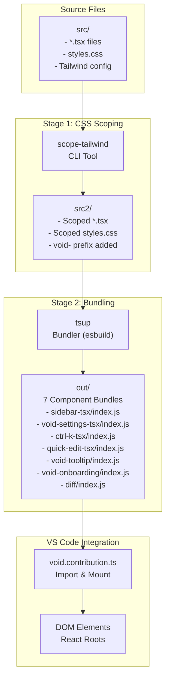
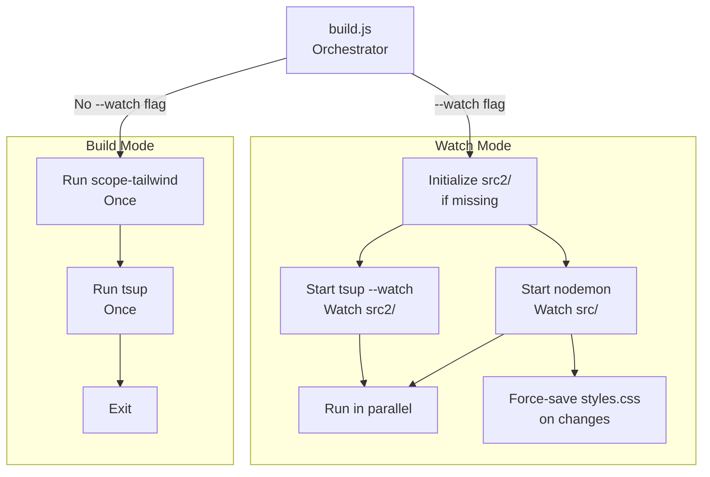
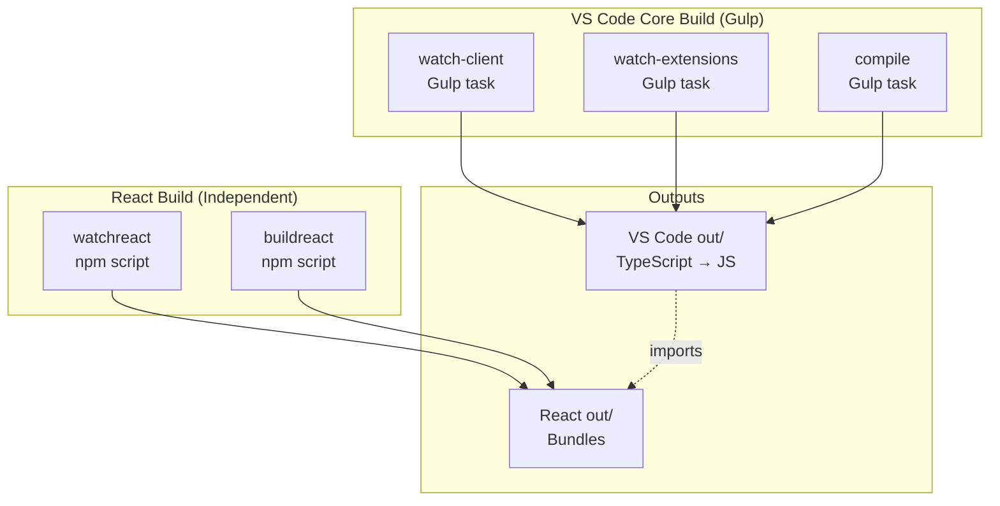

# Build System and Pipeline

<details>
<summary>Relevant source files</summary>

The following files were used as context for generating this wiki page:

- [.devcontainer/devcontainer.json](.devcontainer/devcontainer.json)
- [.devcontainer/post-create.sh](.devcontainer/post-create.sh)

</details>


This page documents Void's React build system, which transforms React components with Tailwind CSS into bundled ESM modules that integrate with VS Code. The system uses a two-stage pipeline: CSS scoping with `scope-tailwind`, followed by bundling with `tsup`.

For information about the overall VS Code build system (gulp-based), see [Development Environment Setup](#5.3). For details on how the built React components integrate with VS Code at runtime, see [React Component Architecture](#5.2).

---

## Overview

Void's React components require special build treatment because they must coexist with VS Code's global styles without conflicts. The build system solves this through CSS scoping and bundling into standalone modules.

### Build Pipeline Architecture

The pipeline consists of a transformation stage that prefixes CSS classes to avoid namespace collisions, followed by an esbuild-powered bundling stage.

Title: React Build Data Flow


**Sources:** [package.json:13-14](), [src/vs/workbench/contrib/void/browser/react/build.js:80-154](), [src/vs/workbench/contrib/void/browser/react/tsup.config.js:9-17]()

---

## Stage 1: CSS Scoping with scope-tailwind

The first stage uses `scope-tailwind` to prevent CSS conflicts with VS Code's global styles.

### Scoping Transformation

The `scope-tailwind` tool transforms all CSS classes and Tailwind directives:

| Original File | Transformation | Output File |
|---------------|----------------|-------------|
| `src/Component.tsx` | Add `void-` prefix to all className attributes | `src2/Component.tsx` |
| `src/styles.css` | Wrap all styles in `.void-scope` selector, prefix utilities | `src2/styles.css` |

**Command executed:**
```bash
npx scope-tailwind ./src -o src2/ -s void-scope -c styles.css -p "void-"
```

**Parameters:**
- `./src`: Input directory with React source files.
- `-o src2/`: Output directory for scoped files.
- `-s void-scope`: CSS scope class name wrapper.
- `-c styles.css`: Target CSS file to transform.
- `-p "void-"`: Prefix for CSS classes.

**Sources:** [src/vs/workbench/contrib/void/browser/react/build.js:88-92](), [src/vs/workbench/contrib/void/browser/react/build.js:148]()

---

## Stage 2: Bundling with tsup

The second stage uses `tsup` (a TypeScript bundler built on esbuild) to create standalone ESM modules.

### Bundle Configuration

Title: tsup Entry Points to Bundles

```mermaid
graph LR
    subgraph "Entry Points (src2/)"
        E1["sidebar-tsx/<br/>index.tsx"]
        E2["void-settings-tsx/<br/>index.tsx"]
        E3["quick-edit-tsx/<br/>index.tsx"]
        E4["void-tooltip/<br/>index.tsx"]
        E5["void-onboarding/<br/>index.tsx"]
        E6["diff/<br/>index.tsx"]
        E7["void-editor-widgets-tsx/<br/>index.tsx"]
    end
    
    subgraph "tsup Configuration"
        Config["tsup.config.js<br/>- format: esm<br/>- injectStyle: true<br/>- platform: browser<br/>- treeshake: true"]
    end
    
    subgraph "Output Bundles (out/)"
        O1["sidebar-tsx/<br/>index.js"]
        O2["void-settings-tsx/<br/>index.js"]
        O3["quick-edit-tsx/<br/>index.js"]
        O4["void-tooltip/<br/>index.js"]
        O5["void-onboarding/<br/>index.js"]
        O6["diff/<br/>index.js"]
        O7["void-editor-widgets-tsx/<br/>index.js"]
    end
    
    E1 --> Config
    E2 --> Config
    E3 --> Config
    E4 --> Config
    E5 --> Config
    E6 --> Config
    E7 --> Config
    
    Config --> O1
    Config --> O2
    Config --> O3
    Config --> O4
    Config --> O5
    Config --> O6
    Config --> O7
```


**Sources:** [src/vs/workbench/contrib/void/browser/react/tsup.config.js:9-17]()

### tsup Configuration Details

**Key Configuration Options:**

| Option | Value | Purpose |
|--------|-------|---------|
| `format` | `['esm']` | Output as ECMAScript modules for dynamic import support. |
| `injectStyle` | `true` | Inline CSS into JavaScript bundles to simplify asset loading. |
| `platform` | `'browser'` | Optimize for browser environment. |
| `target` | `'esnext'` | Use latest JavaScript features. |
| `treeshake` | `true` | Remove unused code. |
| `splitting` | `false` | Disable code splitting between bundles to keep them self-contained. |

**Sources:** [src/vs/workbench/contrib/void/browser/react/tsup.config.js:19-29]()

### Dependency Handling

The configuration carefully controls which imports are bundled vs. kept external:

```javascript
// Bundle all npm packages (react, lucide-react, etc.)
noExternal: [
  /^(?!\.).*$/  // Matches anything not starting with "."
]

// Keep VS Code service imports external
external: [
  /\.\.\/\.\.\/\.\.\/.*\.js/  // Matches ../../../*.js
]
```

This ensures React and UI libraries are bundled into the output, while VS Code service imports (e.g., `../../../services/voidEditCodeService`) remain external and resolve at runtime within the workbench.

**Sources:** [src/vs/workbench/contrib/void/browser/react/tsup.config.js:31-38]()

---

## Build Orchestration Script

The `build.js` script orchestrates both stages and provides watch mode for development.

### Build Modes

Title: build.js Execution Logic


**Sources:** [src/vs/workbench/contrib/void/browser/react/build.js:80-154]()

### Watch Mode Implementation

In watch mode, `build.js` uses `nodemon` to watch the `src` directory for changes and re-run `scope-tailwind`. Simultaneously, `tsup --watch` monitors the generated `src2` directory to re-bundle the modules.

**Sources:** [src/vs/workbench/contrib/void/browser/react/build.js:86-112]()

### Hot Reload Optimization

A specific optimization in `build.js` force-saves `styles.css` after `scope-tailwind` completes. This triggers VS Code's internal file watcher to reload styles without a full workbench restart.

```javascript
function saveStylesFile() {
  setTimeout(() => {
    const pathToCssFile = findDesiredPathFromLocalPath(
      './src/vs/workbench/contrib/void/browser/react/src2/styles.css', 
      __dirname
    );
    const content = fs.readFileSync(pathToCssFile, 'utf8');
    fs.writeFileSync(pathToCssFile, content, 'utf8');
    console.log('[scope-tailwind] Force-saved styles.css');
  }, 6000);
}
```

**Sources:** [src/vs/workbench/contrib/void/browser/react/build.js:60-78](), [src/vs/workbench/contrib/void/browser/react/build.js:116-119]()

---

## Integration with VS Code Build

### Relationship to Main Build System

Void's React build is decoupled from the core VS Code build system (which uses Gulp).

Title: System Build Separation


**Key Points:**
- The React build must be run alongside the main VS Code build during development.
- `package.json` defines `buildreact` and `watchreact` for this purpose.
- VS Code's TypeScript code imports the React bundles dynamically at runtime.

**Sources:** [package.json:13-15](), [package.json:23-24](), [package.json:31-36]()

---

## Dev Container and Environment

The build environment is pre-configured in the project's Dev Container, ensuring all dependencies (Node.js, Rust for certain features) are available.

### Post-Creation Setup

The `.devcontainer/post-create.sh` script automates the initial dependency installation and starts the electron build process to verify the environment.

```bash
#!/bin/sh
npm i
npm run electron
```

**Sources:** [.devcontainer/post-create.sh:3-4](), [.devcontainer/devcontainer.json:22]()