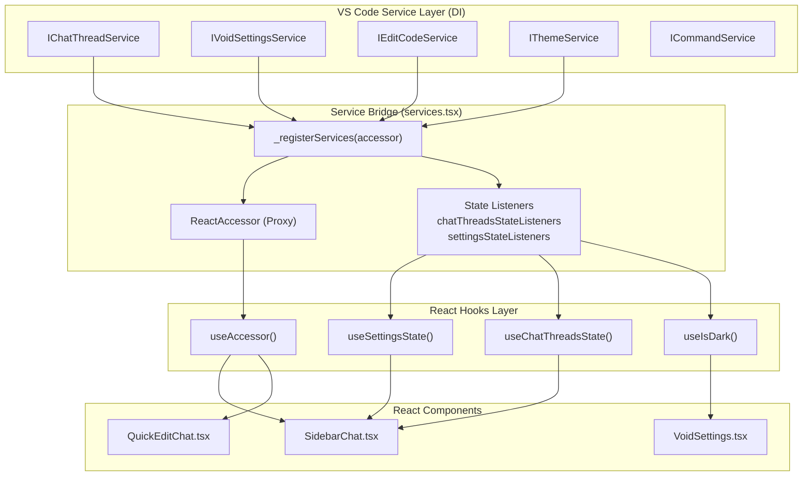
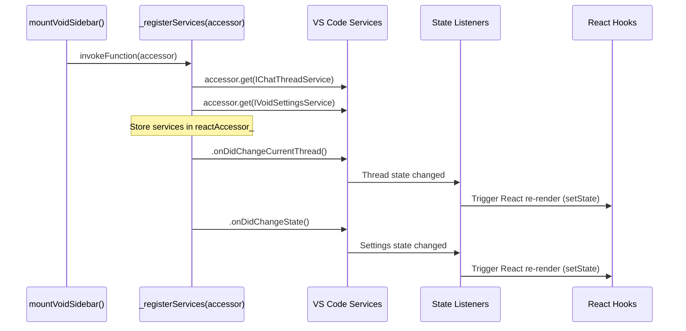
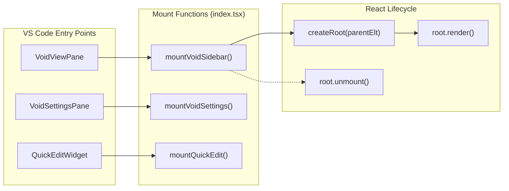

# React Component Architecture

<details>
<summary>Relevant source files</summary>

The following files were used as context for generating this wiki page:

- [.voidrules](.voidrules)

</details>


This page documents how React components are integrated into Void's VS Code-based architecture. It covers the service bridge pattern, custom hooks for state management, component lifecycle, and the build pipeline that transforms modern React code into VS Code-compatible bundles.

For information about the build system and bundling process, see [Build System and Pipeline](#5.1). For VS Code integration patterns and extension APIs, see [VS Code Integration Patterns](#5.4).

---

## Architecture Overview

Void uses React 19 for seven distinct UI components that are bundled separately and mounted into VS Code at runtime. These components need access to VS Code's service layer, which is designed for TypeScript dependency injection, not React hooks. The solution is a **service bridge pattern** that exposes VS Code services through custom React hooks.

### System Data Flow: Services to React

This diagram shows how VS Code services are mapped to React entities.



**Sources:** [src/vs/workbench/contrib/void/browser/react/src/util/services.tsx:1-428]()

---

## Service Bridge Pattern

### Registration: `_registerServices`

The `_registerServices` function is called **exactly once** when a component is mounted. It bridges VS Code's service layer to React's hook-based state management.



The function performs two critical tasks:
1. **Service Registration**: Stores a `ReactAccessor` object containing 30+ VS Code services in a module-level variable `reactAccessor_` [src/vs/workbench/contrib/void/browser/react/src/util/services.tsx:88-181]().
2. **Listener Registration**: Sets up listeners that synchronize VS Code service events with global state variables and triggers React state updates via `Set<fn>` collections [src/vs/workbench/contrib/void/browser/react/src/util/services.tsx:64-84]().

**Sources:** [src/vs/workbench/contrib/void/browser/react/src/util/services.tsx:64-181]()

---

## Core Hooks

### `useAccessor()` - Service Access

The primary hook for accessing any VS Code service. It returns an object with a `get()` method that retrieves services by their interface name [src/vs/workbench/contrib/void/browser/react/src/util/services.tsx:247-253]().

```typescript
const accessor = useAccessor();
const editCodeService = accessor.get('IEditCodeService');
const commandService = accessor.get('ICommandService');
```

### State Management Hooks

These hooks automatically re-render components when VS Code service state changes:

| Hook | Returns | Listens To | File Reference |
|------|---------|------------|----------------|
| `useSettingsState()` | `VoidSettingsState` | `IVoidSettingsService.onDidChangeState()` | [src/vs/workbench/contrib/void/browser/react/src/util/services.tsx:259-270]() |
| `useChatThreadsState()` | `ThreadsState` | `IChatThreadService.onDidChangeCurrentThread()` | [src/vs/workbench/contrib/void/browser/react/src/util/services.tsx:273-284]() |
| `useChatThreadsStreamState(threadId)` | `ThreadStreamState` | `IChatThreadService.onDidChangeStreamState()` | [src/vs/workbench/contrib/void/browser/react/src/util/services.tsx:287-302]() |
| `useIsDark()` | `boolean` | `IThemeService.onDidColorThemeChange()` | [src/vs/workbench/contrib/void/browser/react/src/util/services.tsx:346-357]() |
| `useMCPServiceState()` | `MCPState` | `IMCPService.onDidChangeState()` | [src/vs/workbench/contrib/void/browser/react/src/util/services.tsx:393-404]() |

---

## Component Mounting and Lifecycle

### The Mount Pattern

Each component entry point implements a `mount` function (e.g., `mountVoidSettings`). This function is the bridge between the VS Code class-based environment and the React root.



For example, in `VoidSettingsPane`, the `mountVoidSettings` function is called during the `createEditor` lifecycle [src/vs/workbench/contrib/void/browser/voidSettingsPane.ts:92-95]().

**Sources:** [src/vs/workbench/contrib/void/browser/voidSettingsPane.ts:77-100](), [src/vs/workbench/contrib/void/browser/react/src/util/services.tsx:88-181]()

---

## The Seven UI Components

Void bundles seven React component packages, defined in `tsup.config.js` [src/vs/workbench/contrib/void/browser/react/tsup.config.js:9-17]():

| Component Name | Entry Path | Usage |
|:---|:---|:---|
| `sidebar-tsx` | `src2/sidebar-tsx/index.tsx` | Main AI Chat sidebar |
| `void-settings-tsx` | `src2/void-settings-tsx/index.tsx` | AI Provider and Model settings |
| `quick-edit-tsx` | `src2/quick-edit-tsx/index.tsx` | Ctrl+K inline editing UI |
| `ctrl-k-tsx` | `src2/ctrl-k-tsx/index.tsx` | Legacy Ctrl+K implementation |
| `void-tooltip` | `src2/void-tooltip/index.tsx` | Custom tooltips |
| `void-onboarding` | `src2/void-onboarding/index.tsx` | First-run setup flow |
| `diff` | `src2/diff/index.tsx` | Inline diff accept/reject controls |

---

## Build Pipeline Integration

### Two-Stage Pipeline

Void uses a unique two-stage build process to handle Tailwind CSS scoping and VS Code compatibility [src/vs/workbench/contrib/void/browser/react/build.js:1-154]().

1.  **Stage 1: Scoping**: `scope-tailwind` reads `src/` and outputs to `src2/`. It prefixes all Tailwind classes (e.g., `flex` becomes `void-flex`) to prevent style leakage into the rest of VS Code.
2.  **Stage 2: Bundling**: `tsup` bundles the code from `src2/` into `out/`. It treats VS Code internal imports as external [src/vs/workbench/contrib/void/browser/react/tsup.config.js:28]().

### Watch Mode Implementation
The `build.js` script implements a custom watch mode using `nodemon` to trigger the scoping stage, followed by `tsup`'s native watch mode for the bundling stage [src/vs/workbench/contrib/void/browser/react/build.js:81-142]().

**Sources:** [src/vs/workbench/contrib/void/browser/react/build.js:1-154](), [src/vs/workbench/contrib/void/browser/react/tsup.config.js:1-43]()

---

## Common Patterns in Components

### Quick Edit Integration
The `QuickEditChat` component demonstrates how React UI interacts with the `IEditCodeService` to apply changes [src/vs/workbench/contrib/void/browser/react/src/quick-edit-tsx/QuickEditChat.tsx:18-138]().

```typescript
// Pattern: Accessing services and submitting AI edits
const accessor = useAccessor();
const editCodeService = accessor.get('IEditCodeService');

const onSubmit = useCallback(async () => {
    // ... logic to prepare instructions ...
    await editCodeService.callBeforeApplyOrEdit({
        from: 'QuickEdit',
        diffareaid,
    });
}, [editCodeService, diffareaid]);
```

### Type Safety in Service Registry
The `ReactAccessor` type in `services.tsx` ensures that calls to `accessor.get(serviceName)` are type-safe, mapping string identifiers to their respective VS Code interface types [src/vs/workbench/contrib/void/browser/react/src/util/services.tsx:185-235]().

**Sources:** [src/vs/workbench/contrib/void/browser/react/src/quick-edit-tsx/QuickEditChat.tsx:18-138](), [src/vs/workbench/contrib/void/browser/react/src/util/services.tsx:185-235]()