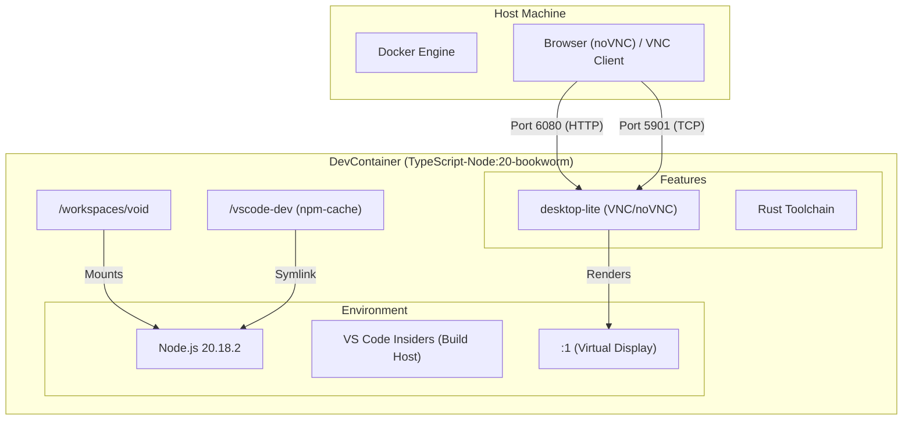
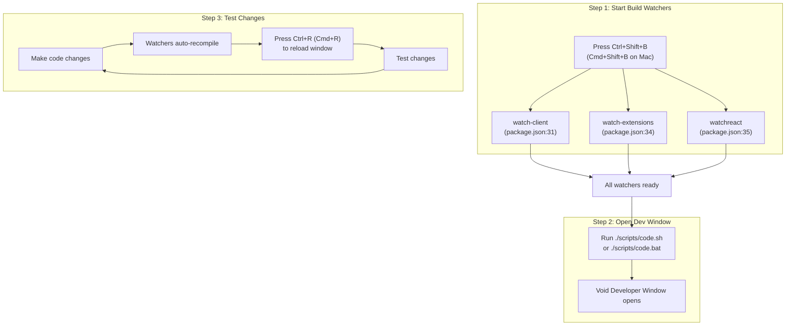
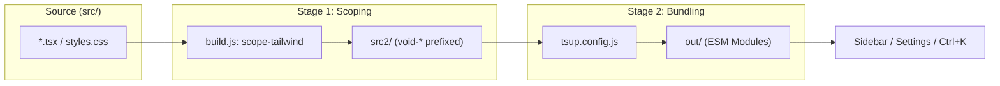

# Development Environment Setup

<details>
<summary>Relevant source files</summary>

The following files were used as context for generating this wiki page:

- [.configurations/configuration.dsc.yaml](.configurations/configuration.dsc.yaml)
- [.devcontainer/Dockerfile](.devcontainer/Dockerfile)
- [.devcontainer/devcontainer-lock.json](.devcontainer/devcontainer-lock.json)
- [.devcontainer/devcontainer.json](.devcontainer/devcontainer.json)
- [.devcontainer/install-vscode.sh](.devcontainer/install-vscode.sh)
- [.npmrc](.npmrc)
- [.nvmrc](.nvmrc)

</details>


This document covers the prerequisites, initial setup, and workflow for running Void in development mode. This allows contributors to make changes to Void's source code and test them locally in a live development window.

For information about the build pipeline architecture (scope-tailwind and tsup), see [Build System and Pipeline](#5.1). For general contribution guidelines and distribution, see [Contributing to Void](#1.2).

---

## Purpose and Scope

This page documents how to set up a local development environment for Void, covering:
- Platform-specific prerequisites (compilers, build tools, Python)
- Automated setup using Windows DSC
- Containerized development via DevContainers (with VNC access)
- Initial repository setup and dependency installation
- Running Void in Developer Mode with live reloading
- Available npm scripts for building and watching

---

## Platform-Specific Prerequisites

Void requires native build tools because VS Code and several of its dependencies (like `node-pty`, `native-keymap`, `kerberos`) must be compiled from C/C++ source. The prerequisites vary by platform.

### Mac Prerequisites

Mac users need:
- **Python** (usually pre-installed)
- **XCode** or XCode Command Line Tools (usually pre-installed)

These are typically already available on Mac systems and require no additional setup.

**Sources:** [HOW_TO_CONTRIBUTE.md:27-29]()

---

### Windows Prerequisites

Windows requires Visual Studio with specific workloads for native compilation.

#### Manual Installation
**Required Software:**
- [Visual Studio 2022 Community](https://visualstudio.microsoft.com/thank-you-downloading-visual-studio/?sku=Community) (recommended) or VS Build Tools

**Required Workloads** (in "Workloads" tab):
- `Desktop development with C++`
- `Node.js build tools`

**Required Components** (in "Individual Components" tab):
- `MSVC v143 - VS 2022 C++ x64/x86 Spectre-mitigated libs (Latest)`
- `C++ ATL for latest build tools with Spectre Mitigations`
- `C++ MFC for latest build tools with Spectre Mitigations`

#### Automated Setup (DSC)
Windows users can use the provided Desired State Configuration (DSC) file to automate the installation of prerequisites via `winget`.

The configuration file `configuration.dsc.yaml` automates:
1. **Git** installation [configuration.dsc.yaml:5-11]()
2. **Node.js 20.14.0** (LTS) [configuration.dsc.yaml:12-20]()
3. **Python 3.10** [configuration.dsc.yaml:21-27]()
4. **Visual Studio 2022 Build Tools** [configuration.dsc.yaml:28-35]()
5. **C++ Build Tools** (Microsoft.VisualStudio.Workload.VCTools) [configuration.dsc.yaml:36-47]()
6. **npm install** in the project directory [configuration.dsc.yaml:48-55]()

**Sources:** [.configurations/configuration.dsc.yaml:1-56](), [HOW_TO_CONTRIBUTE.md:31-44]()

---

### Linux Prerequisites

Linux distributions require build tools and development libraries:

**Debian/Ubuntu:**
```bash
sudo apt-get install build-essential g++ libx11-dev libxkbfile-dev libsecret-1-dev libkrb5-dev python-is-python3
```

**Red Hat/Fedora:**
```bash
sudo dnf install @development-tools gcc gcc-c++ make libsecret-devel krb5-devel libX11-devel libxkbfile-devel
```

**All Distributions:**
```bash
npm install -g node-gyp
```

**Sources:** [HOW_TO_CONTRIBUTE.md:46-53]()

---

## Containerized Development (DevContainer)

Void provides a pre-configured DevContainer for a consistent environment regardless of the host OS. This is particularly useful for Linux users who want to avoid manual dependency management or Windows users who prefer a Linux-based build environment.

### DevContainer Architecture



**Key Features:**
- **Base Image:** `mcr.microsoft.com/devcontainers/typescript-node:20-bookworm` [.devcontainer/Dockerfile:1]()
- **Desktop Access:** Uses `desktop-lite` feature to provide a virtual desktop accessible via VNC (Port 5901) or a web browser (Port 6080) [.devcontainer/devcontainer.json:7,39-49]()
- **Display Configuration:** Automatically sets `DISPLAY` to `:1` in `.bashrc` and `.zshrc` [.devcontainer/Dockerfile:11]()
- **Persistence:** Mounts a volume `vscode-dev` to `/vscode-dev` to cache `npm` dependencies between container rebuilds [.devcontainer/devcontainer.json:15-20](), [.devcontainer/Dockerfile:10,14]()
- **Tooling:** Installs `code-insiders`, `libsecret-1-dev`, `libxkbfile-dev`, and `libkrb5-dev` [.devcontainer/install-vscode.sh:12]()

**Sources:** [.devcontainer/devcontainer.json:1-53](), [.devcontainer/Dockerfile:1-14](), [.devcontainer/install-vscode.sh:1-12]()

---

## Initial Setup

### Cloning and Installing Dependencies

```bash
# Clone the repository
git clone https://github.com/voideditor/void

# Navigate to directory
cd void

# Install dependencies
npm install
```

The `npm install` step will:
1. Install JavaScript dependencies from [package.json:74-138]()
2. Compile native modules (kerberos, node-pty, native-keymap, etc.)
3. Run postinstall scripts defined in [package.json:22]()

**Note:** The `.npmrc` file specifies that native modules should be built from source using Electron headers (version 34.3.2) [.npmrc:1-5]().

**Sources:** [HOW_TO_CONTRIBUTE.md:59-60](), [package.json:1-274](), [.npmrc:1-7]()

---

### Node Version Requirements

Void requires **Node.js version 20.18.2** (specified in `.nvmrc`).

**Using nvm (recommended):**
```bash
# Install the version from .nvmrc
nvm install

# Use the local version
nvm use
```

**Sources:** [.nvmrc:1](), [HOW_TO_CONTRIBUTE.md:79-80]()

---

## Developer Mode Workflow

Developer Mode runs Void with live file watching. The workflow involves starting build watchers, opening the dev window, and reloading changes.

### Development Mode Process



**Sources:** [HOW_TO_CONTRIBUTE.md:56-73](), [package.json:31-35]()

---

### Available npm Scripts

| Script | Command | Purpose |
|--------|---------|---------|
| **`watch`** | `npm run watch` | Runs `watch-client` and `watch-extensions` [package.json:30]() |
| **`watch-client`** | `npm run watch-client` | Compiles TypeScript in `src/` [package.json:31]() |
| **`watch-extensions`** | `npm run watch-extensions` | Compiles built-in extensions [package.json:34]() |
| **`watchreact`** | `npm run watchreact` | Builds React components with `tsup` [package.json:35]() |
| **`compile`** | `npm run compile` | One-time project compilation [package.json:23]() |

**Sources:** [package.json:23-35]()

---

## React Component Development

React components require a separate build process because they use Tailwind CSS with scoping and must be bundled into standalone modules.

### React Build Architecture



**Sources:** [src/vs/workbench/contrib/void/browser/react/build.js:1-154](), [src/vs/workbench/contrib/void/browser/react/tsup.config.js:1-43]()

---

## Common Issues and Solutions

### Missing Styles in Dev Window
**Symptom:** UI appears unstyled.
**Solution:** Wait for `watchreact` to finish and reload the window (<kbd>Ctrl+R</kbd>). [HOW_TO_CONTRIBUTE.md:84]()

### Path Contains Spaces
**Symptom:** Build fails with obscure errors.
**Solution:** Ensure the repository path contains no spaces. [HOW_TO_CONTRIBUTE.md:81]()

### Wrong Node Version
**Symptom:** Native module compilation fails.
**Solution:** Ensure you are using Node `20.18.2` as specified in `.nvmrc`. [.nvmrc:1](), [HOW_TO_CONTRIBUTE.md:79-80]()

### SUID Sandbox Error (Linux)
**Symptom:** `The SUID sandbox helper binary was found, but is not configured correctly`.
**Solution:**
```bash
sudo chown root:root .build/electron/chrome-sandbox
sudo chmod 4755 .build/electron/chrome-sandbox
```
**Sources:** [HOW_TO_CONTRIBUTE.md:86-87]()

---

## Next Steps

1. **Read the codebase guide**: See [VOID_CODEBASE_GUIDE](https://github.com/voideditor/void/blob/main/VOID_CODEBASE_GUIDE.md) for an overview of Void's architecture.
2. **Understand the build pipeline**: See [Build System and Pipeline](#5.1) for details on the two-stage build process.
3. **Learn React integration**: See [React Component Architecture](#5.2) for how React components integrate with VS Code services.

**Sources:** [VOID_CODEBASE_GUIDE.md:1-168](), [HOW_TO_CONTRIBUTE.md:13-20]()