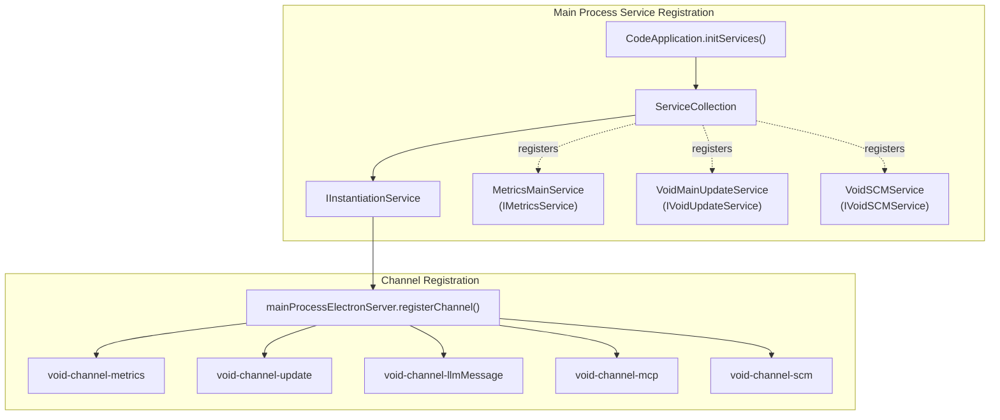
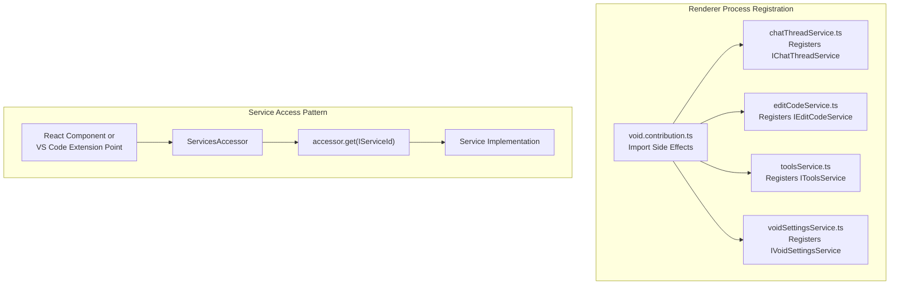
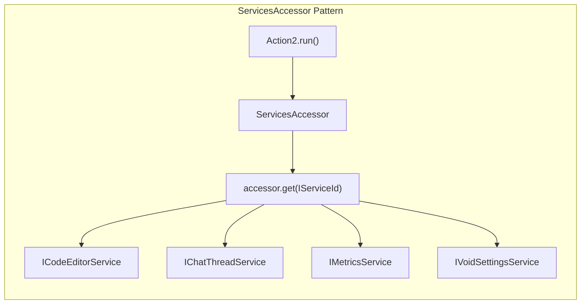
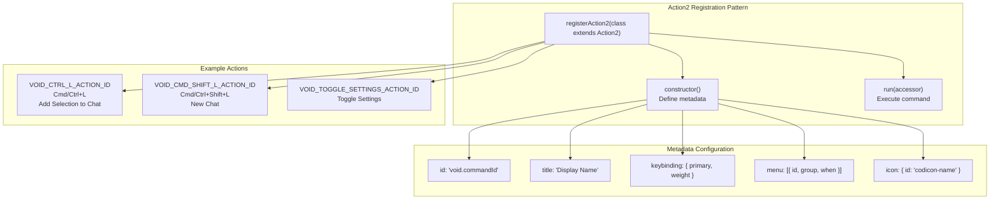

# VS Code Integration Patterns

<details>
<summary>Relevant source files</summary>

The following files were used as context for generating this wiki page:

- [.eslint-plugin-local/code-amd-node-module.ts](.eslint-plugin-local/code-amd-node-module.ts)
- [.eslint-plugin-local/code-declare-service-brand.ts](.eslint-plugin-local/code-declare-service-brand.ts)
- [.eslint-plugin-local/code-import-patterns.ts](.eslint-plugin-local/code-import-patterns.ts)
- [.eslint-plugin-local/code-layering.ts](.eslint-plugin-local/code-layering.ts)
- [.eslint-plugin-local/index.js](.eslint-plugin-local/index.js)

</details>


## Purpose and Scope

This document explains how Void integrates with VS Code's architecture using extension APIs, service injection patterns, and contribution points. It covers:

- Service registration and dependency injection in both main and renderer processes.
- Command and keybinding registration through `Action2`.
- View contributions (sidebar panes, custom editor panes).
- IPC channel patterns for cross-process communication.
- React-to-VS Code service bridging.
- Enforcement of architectural layering via custom ESLint rules.

For information about the build system and React component setup, see [Build System and Pipeline](5.1). For React component implementation patterns, see [React Component Architecture](5.2).

---

## Service Registration and Dependency Injection

Void uses VS Code's instantiation service pattern for dependency injection. Services are registered differently in the main process (Electron) versus the renderer process (browser/UI).

### Main Process Service Registration

In the main process, services are registered in a `ServiceCollection` and instantiated through the main `IInstantiationService`. Void's custom services are registered alongside VS Code's core services.



**Main Process Service Registration Pattern**

Services are registered using `SyncDescriptor` which defers instantiation until needed:

[src/vs/code/electron-main/app.ts:1105-1107]()

```typescript
services.set(IMetricsService, new SyncDescriptor(MetricsMainService, undefined, false));
services.set(IVoidUpdateService, new SyncDescriptor(VoidMainUpdateService, undefined, false));
services.set(IVoidSCMService, new SyncDescriptor(VoidSCMService, undefined, false));
```

The third parameter (`false`) indicates the service is not proxied to other processes automatically - instead, explicit IPC channels are registered.

**Sources:** [src/vs/code/electron-main/app.ts:989-1133]()

---

### Renderer Process Service Registration

In the renderer process, services are registered through VS Code's workbench contribution pattern. Service implementations are instantiated automatically through dependency injection.



**Workbench Contribution Pattern**

Void's services are registered through file imports that execute registration code as side effects:

[src/vs/workbench/contrib/void/browser/void.contribution.ts:7-85]()

Key registrations:
- `editCodeService.js` - Registers `IEditCodeService` for diff zone management.
- `chatThreadService.js` - Registers `IChatThreadService` for conversation state.
- `toolsService.js` - Registers `IToolsService` for LLM tool execution.
- `terminalToolService.js` - Registers `ITerminalToolService` for terminal operations.

**Sources:** [src/vs/workbench/contrib/void/browser/void.contribution.ts:1-85](), [src/vs/workbench/contrib/void/browser/react/src/util/services.tsx:89-181]()

---

### The ServicesAccessor Pattern

The `ServicesAccessor` is VS Code's standard pattern for accessing dependency-injected services. Void uses it extensively in both traditional VS Code extensions and React components.



**Usage in Actions**

[src/vs/workbench/contrib/void/browser/sidebarActions.ts:91-142]()

```typescript
async run(accessor: ServicesAccessor): Promise<void> {
    const commandService = accessor.get(ICommandService)
    const viewsService = accessor.get(IViewsService)
    const metricsService = accessor.get(IMetricsService)
    const editorService = accessor.get(ICodeEditorService)
    const chatThreadService = accessor.get(IChatThreadService)
    
    // Use services...
}
```

**Usage in React Components**

React components access services through a custom hook that wraps the accessor pattern:

[src/vs/workbench/contrib/void/browser/react/src/util/services.tsx:247-253]()

```typescript
export const useAccessor = () => {
    if (!reactAccessor_) {
        throw new Error(`⚠️ Void useAccessor was called before _registerServices!`)
    }
    return { get: <S extends keyof ReactAccessor,>(service: S): ReactAccessor[S] => reactAccessor_![service] }
}
```

**Sources:** [src/vs/workbench/contrib/void/browser/sidebarActions.ts:91-143](), [src/vs/workbench/contrib/void/browser/react/src/util/services.tsx:185-253]()

---

## Actions: Commands and Keybindings

Void registers commands and keybindings through VS Code's `Action2` pattern, which provides a unified way to declare commands, keybindings, menu items, and context menu entries.

### Registering Actions with Action2



**Action2 Registration Example**

[src/vs/workbench/contrib/void/browser/sidebarActions.ts:79-143]()

```typescript
registerAction2(class extends Action2 {
    constructor() {
        super({
            id: VOID_CTRL_L_ACTION_ID,
            f1: true,  // Show in command palette
            title: localize2('voidCmdL', 'Void: Add Selection to Chat'),
            keybinding: {
                primary: KeyMod.CtrlCmd | KeyCode.KeyL,
                weight: KeybindingWeight.VoidExtension
            }
        });
    }
    async run(accessor: ServicesAccessor): Promise<void> {
        const editorService = accessor.get(ICodeEditorService)
        const chatThreadService = accessor.get(IChatThreadService)
        // ... implementation
    }
})
```

**Sources:** [src/vs/workbench/contrib/void/browser/sidebarActions.ts:79-143]()

---

### Menu Contributions

Actions can contribute to various VS Code menus through the `menu` property in the `Action2` constructor.

[src/vs/workbench/contrib/void/browser/sidebarActions.ts:148-160]()

```typescript
registerAction2(class extends Action2 {
    constructor() {
        super({
            id: VOID_CMD_SHIFT_L_ACTION_ID,
            title: 'New Chat',
            keybinding: {
                primary: KeyMod.CtrlCmd | KeyMod.Shift | KeyCode.KeyL,
                weight: KeybindingWeight.VoidExtension,
            },
            icon: { id: 'add' },
            menu: [{
                id: MenuId.ViewTitle,
                group: 'navigation',
                when: ContextKeyExpr.equals('view', VOID_VIEW_ID),
            }],
        });
    }
})
```

**MenuRegistry for Static Contributions**

For programmatic menu additions without commands:

[src/vs/workbench/contrib/void/browser/voidSettingsPane.ts:201-208]()

```typescript
MenuRegistry.appendMenuItem(MenuId.GlobalActivity, {
    group: '0_command',
    command: {
        id: VOID_TOGGLE_SETTINGS_ACTION_ID,
        title: nls.localize('voidSettingsActionGear', "Void's Settings")
    },
    order: 1
});
```

**Sources:** [src/vs/workbench/contrib/void/browser/sidebarActions.ts:148-252](), [src/vs/workbench/contrib/void/browser/voidSettingsPane.ts:201-208]()

---

## View Contributions

Void extends VS Code's UI by contributing custom views: sidebar panes for chat and custom editor panes for settings.

### Custom Editor Panes

Void registers a custom editor pane for its settings UI, demonstrating how to create custom editors that render React content.

**EditorInput Definition**

[src/vs/workbench/contrib/void/browser/voidSettingsPane.ts:33-59]()

```typescript
class VoidSettingsInput extends EditorInput {
    static readonly ID: string = 'workbench.input.void.settings';
    // ...
}
```

**EditorPane Definition**

[src/vs/workbench/contrib/void/browser/voidSettingsPane.ts:62-111]()

```typescript
class VoidSettingsPane extends EditorPane {
    protected createEditor(parent: HTMLElement): void {
        // ...
        this.instantiationService.invokeFunction(accessor => {
            const disposeFn = mountVoidSettings(settingsElt, accessor)?.dispose;
            this._register(toDisposable(() => disposeFn?.()))
        });
    }
}
```

**Sources:** [src/vs/workbench/contrib/void/browser/voidSettingsPane.ts:33-117]()

---

## IPC Channel Registration

Void uses IPC channels to communicate between the renderer process (browser) and main process (Node.js) for operations requiring native Node.js APIs.

**Channel Registration in Main Process**

[src/vs/code/electron-main/app.ts:1239-1255]()

```typescript
private initChannels(accessor: ServicesAccessor, mainProcessElectronServer: ElectronIPCServer, ...): void {
    const disposables = this._register(new DisposableStore());
    
    const metricsChannel = ProxyChannel.fromService(accessor.get(IMetricsService), disposables);
    mainProcessElectronServer.registerChannel('void-channel-metrics', metricsChannel);
    
    const sendLLMMessageChannel = new LLMMessageChannel(accessor.get(IMetricsService));
    mainProcessElectronServer.registerChannel('void-channel-llmMessage', sendLLMMessageChannel);
}
```

**Sources:** [src/vs/code/electron-main/app.ts:1135-1268]()

---

## React-to-VS Code Service Bridge

Void's React components access VS Code services through a bridge that synchronizes service state to React hooks.

**_registerServices Implementation**

[src/vs/workbench/contrib/void/browser/react/src/util/services.tsx:89-181]()

This function sets up listeners that trigger re-renders in React when the underlying VS Code services change state.

```typescript
export const _registerServices = (accessor: ServicesAccessor) => {
    // ...
    disposables.push(
        chatThreadsStateService.onDidChangeCurrentThread(() => {
            chatThreadsState = chatThreadsStateService.state
            chatThreadsStateListeners.forEach(l => l(chatThreadsState))
        })
    )
    // ...
}
```

**Sources:** [src/vs/workbench/contrib/void/browser/react/src/util/services.tsx:89-181]()

---

## Architectural Enforcement via ESLint

Void employs custom ESLint rules to enforce VS Code's strict architectural layering (e.g., preventing the browser layer from importing Node.js modules).

### Layering Rules

The `code-layering` rule ensures that code in one layer (like `browser`) does not access restricted layers (like `node` or `electron-main`).

[path/to/file:.eslint-plugin-local/code-layering.ts:15-93]()

```typescript
// .eslint-plugin-local/code-layering.ts
// Enforces that 'browser' cannot import from 'node', etc.
create(context: eslint.Rule.RuleContext): eslint.Rule.RuleListener {
    // ... implementation logic for allowed/disallowed layers
}
```

### Service Brand Enforcement

The `code-declare-service-brand` rule ensures that service interfaces are correctly declared for the instantiation service.

[.eslint-plugin-local/code-declare-service-brand.ts:8-28]()

```typescript
// Ensures _serviceBrand is declared as undefined
['PropertyDefinition[key.name="_serviceBrand"][value]']: (node: any) => {
    return context.report({
        node,
        message: `The '_serviceBrand'-property should not have a value`,
        fix: (fixer) => fixer.replaceText(node, 'declare _serviceBrand: undefined;')
    });
}
```

### Import Patterns

The `code-import-patterns` rule restricts imports based on the target environment (Common, Browser, Node, Electron).

[.eslint-plugin-local/code-import-patterns.ts:42-105]()

**Sources:** [.eslint-plugin-local/code-layering.ts:1-93](), [.eslint-plugin-local/code-declare-service-brand.ts:1-28](), [.eslint-plugin-local/code-import-patterns.ts:1-202](), [.eslint-plugin-local/index.js:1-16]()

---

## Summary

Void's integration with VS Code follows several key patterns:

1.  **Service Registration**: Services are registered through `SyncDescriptor` in the main process and through import side-effects in the renderer.
2.  **Dependency Injection**: The `ServicesAccessor` pattern provides type-safe access to services.
3.  **Action2**: Commands, keybindings, and menu items are registered through a unified `Action2` class.
4.  **View Contributions**: Custom sidebar panes and editor panes extend VS Code's UI.
5.  **IPC Channels**: `ProxyChannel` for simple services, custom channels for complex streaming operations.
6.  **React Bridge**: `useAccessor` hook and state synchronization listeners connect React to VS Code services.
7.  **Linting Enforcement**: Custom local ESLint rules enforce strict architectural boundaries between process layers.