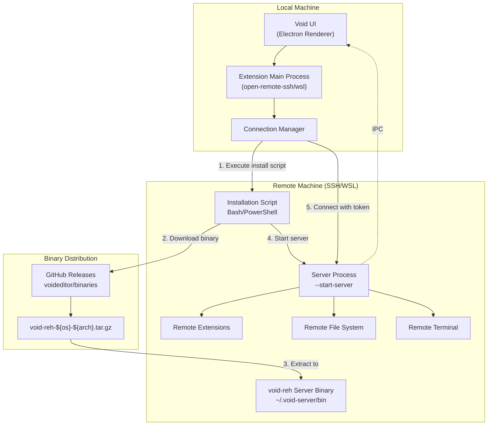
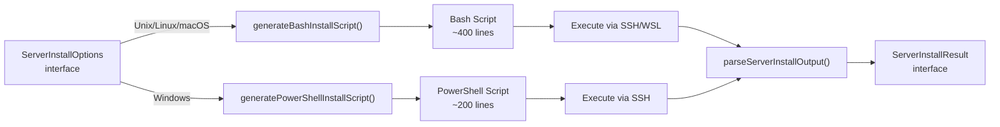
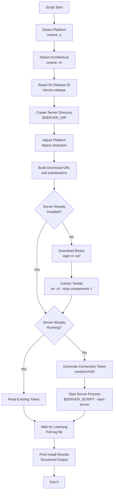
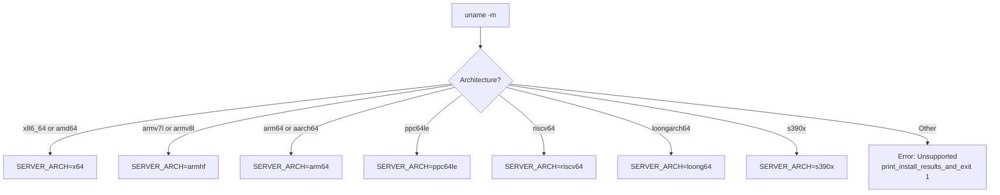
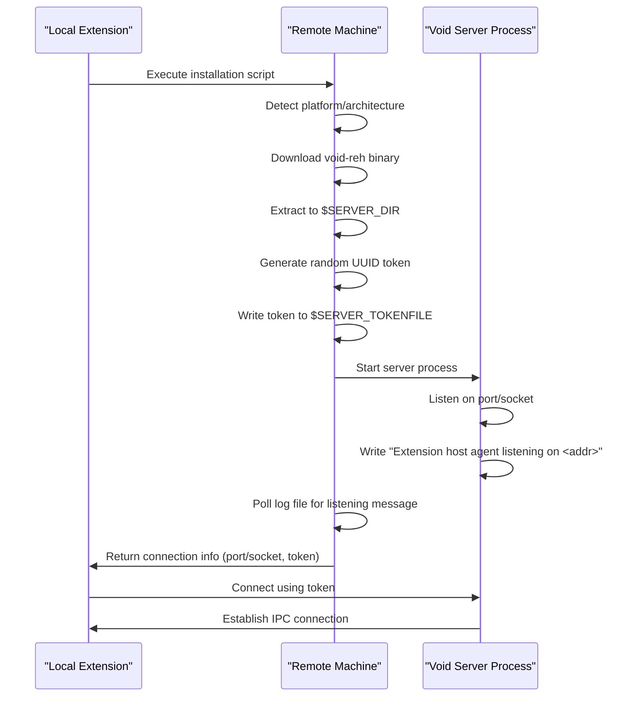
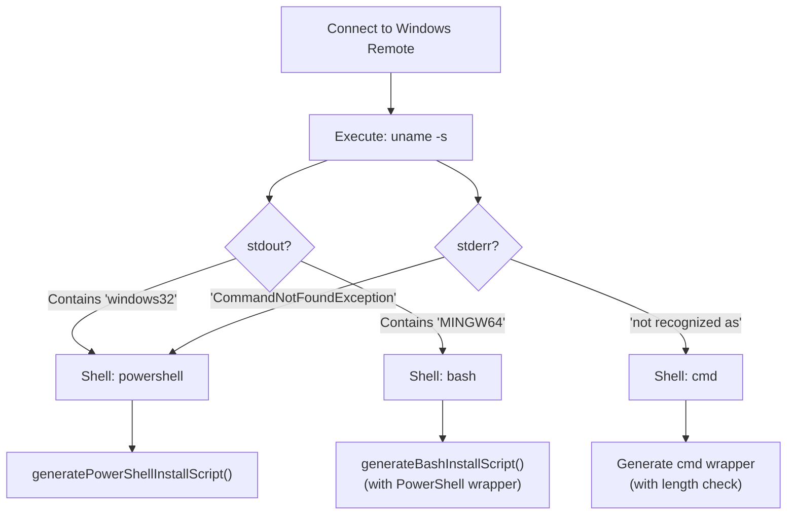

# Remote Development and Server Setup

<details>
<summary>Relevant source files</summary>

The following files were used as context for generating this wiki page:

- [.devcontainer/README.md](.devcontainer/README.md)
- [.devcontainer/devcontainer.json](.devcontainer/devcontainer.json)

</details>


This document covers Void's remote development capabilities, which allow you to use a remote machine (accessed via SSH or WSL) as your development environment. The remote machine runs a headless Void server (`void-reh`) that handles file operations, terminal sessions, and extension hosting, while the UI runs locally.

For information about the build system and local development setup, see [Development Environment Setup](#5.3). For VS Code integration patterns, see [VS Code Integration Patterns](#5.4).

## Overview

Void includes two built-in remote extensions that enable development on remote machines:

| Extension | Authority | Use Case |
|-----------|-----------|----------|
| `open-remote-ssh` | `ssh-remote` | Connect to remote Linux/macOS/Windows machines via SSH |
| `open-remote-wsl` | `wsl` | Connect to Windows Subsystem for Linux distributions |

Both extensions follow the same pattern: they detect the remote platform/architecture, download the appropriate Void server binary, install and start the server, then establish a connection using a secure token.

**Sources:** [extensions/open-remote-ssh/package.json:1-351](), [extensions/open-remote-wsl/package.json:1-281]()

## Remote Development Architecture



**Sources:** [extensions/open-remote-ssh/src/serverSetup.ts:1-626](), [extensions/open-remote-wsl/src/serverSetup.ts:1-353]()

## Dev Container Support

Void supports development inside Docker containers via the Dev Containers extension. This is particularly useful for maintaining a consistent build environment for Void itself.

### Configuration
The project includes a `.devcontainer` configuration that sets up a full development environment:
- **Features**: Includes `desktop-lite` for VNC access and `rust` for CLI/tunnel components [ .devcontainer/devcontainer.json:6-9]().
- **Resources**: Requires at least 4 cores and 9GB of RAM [ .devcontainer/devcontainer.json:50-53](), [ .devcontainer/README.md:15-17]().
- **Desktop Access**: Provides a VNC server on port `5901` and a noVNC web client on port `6080` [ .devcontainer/devcontainer.json:39-49](), [ .devcontainer/README.md:7-8]().

### Development Workflow in Container
1. **Build**: Run `npm i` and `bash scripts/code.sh` inside the container terminal [ .devcontainer/README.md:87-90]().
2. **Access**: Connect via VNC viewer to `localhost:5901` (password: `vscode`) to see the Code - OSS / Void UI [ .devcontainer/README.md:92-94]().
3. **Debug**: Use the `VS Code` launch configuration in the local client to attach to the process running in the container [ .devcontainer/README.md:100-104]().

**Sources:** [ .devcontainer/devcontainer.json:1-53](), [ .devcontainer/README.md:1-110]()

## Server Installation Process

### Installation Script Generation

Both extensions generate platform-specific installation scripts at runtime. The core logic resides in `installCodeServer` functions:

- **SSH:** `installCodeServer(conn, serverDownloadUrlTemplate, extensionIds, envVariables, platform, useSocketPath, logger)` [extensions/open-remote-ssh/src/serverSetup.ts:44-177]()
- **WSL:** `installCodeServer(wslManager, distroName, serverDownloadUrlTemplate, extensionIds, envVariables, logger)` [extensions/open-remote-wsl/src/serverSetup.ts:44-109]()



**Sources:** [extensions/open-remote-ssh/src/serverSetup.ts:205-426](), [extensions/open-remote-ssh/src/serverSetup.ts:429-626](), [extensions/open-remote-wsl/src/serverSetup.ts:137-353]()

### ServerInstallOptions Interface

The `ServerInstallOptions` interface defines the parameters passed to script generators:

```typescript
interface ServerInstallOptions {
    id: string;                          // Random script ID for output parsing
    quality: string;                     // 'stable' or 'insiders'
    commit: string;                      // Git commit hash
    version: string;                     // Version string (e.g., '1.0.0')
    release?: string;                    // Void-specific release number
    extensionIds: string[];              // Extensions to auto-install
    envVariables: string[];              // Environment variables to capture
    useSocketPath: boolean;              // Use Unix socket vs TCP port (SSH only)
    serverApplicationName: string;       // Binary name (e.g., 'void-server')
    serverDataFolderName: string;        // Data directory name (e.g., '.void-server')
    serverDownloadUrlTemplate: string;   // URL template with ${} variables
}
```

**Sources:** [extensions/open-remote-ssh/src/serverSetup.ts:10-22](), [extensions/open-remote-wsl/src/serverSetup.ts:11-22]()

### ServerInstallResult Interface

After installation, `parseServerInstallOutput` extracts structured data from script output:

```typescript
interface ServerInstallResult {
    exitCode: number;
    listeningOn: number | string;      // Port number or socket path
    connectionToken: string;           // UUID for secure connection
    logFile: string;                   // Server log file path
    osReleaseId: string;               // OS identifier (e.g., 'ubuntu', 'alpine')
    arch: string;                      // Machine architecture
    platform: string;                  // OS platform
    tmpDir: string;                    // Temporary directory path
    [key: string]: any;                // Additional environment variables
}
```

**Sources:** [extensions/open-remote-ssh/src/serverSetup.ts:24-34](), [extensions/open-remote-wsl/src/serverSetup.ts:24-34]()

## Bash Installation Script Flow

The generated bash script follows a multi-stage installation process:



**Key Variables:**
- `$SERVER_DATA_DIR`: `$HOME/.void-server` (configurable)
- `$SERVER_DIR`: `$SERVER_DATA_DIR/bin/$DISTRO_COMMIT`
- `$SERVER_SCRIPT`: `$SERVER_DIR/bin/void-server`
- `$SERVER_LOGFILE`: `$SERVER_DATA_DIR/.$DISTRO_COMMIT.log`
- `$SERVER_TOKENFILE`: `$SERVER_DATA_DIR/.$DISTRO_COMMIT.token`

**Sources:** [extensions/open-remote-ssh/src/serverSetup.ts:205-426](), [extensions/open-remote-wsl/src/serverSetup.ts:137-353]()

## Platform and Architecture Detection

### Supported Platforms

| Platform Value | Detected From | Notes |
|----------------|---------------|-------|
| `linux` | `uname -s` = `Linux` | Standard Linux distributions |
| `alpine` | `/etc/os-release` ID = `alpine` | Uses musl libc instead of glibc |
| `darwin` | `uname -s` = `Darwin` | macOS systems |
| `win32` | `uname -s` contains `windows32` or `MINGW64` | Windows systems (SSH only) |
| `freebsd` | `uname -s` = `FreeBSD` | FreeBSD systems |
| `dragonfly` | `uname -s` = `DragonFly` | DragonFly BSD systems |

**Sources:** [extensions/open-remote-ssh/src/serverSetup.ts:251-270](), [extensions/open-remote-wsl/src/serverSetup.ts:184-194]()

### Architecture Mapping



**Sources:** [extensions/open-remote-ssh/src/serverSetup.ts:273-300]()

### Alpine Linux Special Handling

The bash script includes special logic for Alpine Linux, which uses musl libc instead of glibc:

```bash
# adjust platform for void download, if needed
if [[ $OS_RELEASE_ID = alpine ]]; then
    PLATFORM=$OS_RELEASE_ID
fi
```

This ensures the correct binary is downloaded for Alpine-based systems. [extensions/open-remote-ssh/src/serverSetup.ts:320-323]()

**Sources:** [extensions/open-remote-ssh/src/serverSetup.ts:320-323]()

## Configuration Options

### SSH Extension Settings

The SSH extension exposes configuration through VS Code settings:

| Setting | Type | Default | Description |
|---------|------|---------|-------------|
| `remote.SSH.configFile` | string | `""` | Path to custom SSH config file |
| `remote.SSH.connectTimeout` | number | `60` | SSH connection timeout in seconds |
| `remote.SSH.defaultExtensions` | array | `[]` | Extensions to auto-install on SSH hosts |
| `remote.SSH.enableDynamicForwarding` | boolean | `true` | Use SSH dynamic forwarding for port tunnels |
| `remote.SSH.enableAgentForwarding` | boolean | `true` | Enable SSH agent forwarding |
| `remote.SSH.serverDownloadUrlTemplate` | string | See below | Server binary download URL template |
| `remote.SSH.remotePlatform` | object | `{}` | Map of hostname to platform override |
| `remote.SSH.remoteServerListenOnSocket` | boolean | `false` | Use Unix socket instead of TCP port |

**Sources:** [extensions/open-remote-ssh/package.json:34-101]()

### WSL Extension Settings

The WSL extension has minimal configuration:

| Setting | Type | Default | Description |
|---------|------|---------|-------------|
| `remote.WSL.serverDownloadUrlTemplate` | string | See below | Server binary download URL template |

**Sources:** [extensions/open-remote-wsl/package.json:34-43]()

### Default Download URL Template

Both extensions use the same default download URL:

```
https://github.com/voideditor/binaries/releases/download/${version}/void-reh-${os}-${arch}-${version}.tar.gz
```

Template variables:
- `${quality}`: Server quality (`stable` or `insiders`)
- `${version}`: Server version (e.g., `1.0.0`)
- `${commit}`: Git commit hash
- `${os}`: Operating system (`linux`, `darwin`, `win32`, `alpine`)
- `${arch}`: Architecture (`x64`, `arm64`, `armhf`, etc.)
- `${release}`: Optional release number (Void-specific)

**Sources:** [extensions/open-remote-ssh/src/serverSetup.ts:42](), [extensions/open-remote-wsl/src/serverSetup.ts:42]()

## Server Startup and Connection

### Server Command Line Arguments

The server is started with specific flags:

```bash
$SERVER_SCRIPT \
  --start-server \
  --host=127.0.0.1 \
  $SERVER_LISTEN_FLAG \              # --port=0 or --socket-path=...
  $SERVER_INITIAL_EXTENSIONS \       # --install-extension <id> ...
  --connection-token-file $SERVER_TOKENFILE \
  --telemetry-level off \
  --enable-remote-auto-shutdown \
  --accept-server-license-terms \
  &> $SERVER_LOGFILE &
```

**Sources:** [extensions/open-remote-ssh/src/serverSetup.ts:393](), [extensions/open-remote-wsl/src/serverSetup.ts:296]()

### Connection Flow



**Sources:** [extensions/open-remote-ssh/src/serverSetup.ts:373-422](), [extensions/open-remote-wsl/src/serverSetup.ts:275-325]()

### Output Parsing

The installation script outputs structured data that is parsed by `parseServerInstallOutput`:

```
${scriptId}: start
exitCode==0==
listeningOn==51234==
connectionToken==550e8400-e29b-41d4-a716-446655440000==
logFile==/home/user/.void-server/.abc123.log==
osReleaseId==ubuntu==
arch==x86_64==
platform==linux==
tmpDir==/tmp==
${scriptId}: end
```

The parser extracts key-value pairs from lines matching the pattern `key==value==`. [extensions/open-remote-ssh/src/serverSetup.ts:179-203]()

**Sources:** [extensions/open-remote-ssh/src/serverSetup.ts:179-203](), [extensions/open-remote-wsl/src/serverSetup.ts:111-135]()

## Windows Remote Support (SSH Only)

### Shell Detection

For Windows remotes, the SSH extension detects the available shell:



**Sources:** [extensions/open-remote-ssh/src/serverSetup.ts:47-72]()

### PowerShell Script Generation

The PowerShell installation script [extensions/open-remote-ssh/src/serverSetup.ts:429-626]() handles:

- Architecture detection (`$env:PROCESSOR_ARCHITECTURE`)
- Binary download using `Invoke-RestMethod`
- TAR extraction (requires tar.exe on Windows)
- Server startup with hidden window
- Process monitoring to keep connection alive

**Sources:** [extensions/open-remote-ssh/src/serverSetup.ts:429-626]()

## Extension Auto-Installation

Both extensions support auto-installing extensions on the remote server through the `extensionIds` parameter:

```typescript
const extensions = extensionIds.map(id => '--install-extension ' + id).join(' ');
```

These are passed as command-line arguments when starting the server:

```bash
SERVER_INITIAL_EXTENSIONS="--install-extension ms-python.python --install-extension dbaeumer.vscode-eslint"
```

**Sources:** [extensions/open-remote-ssh/src/serverSetup.ts:206](), [extensions/open-remote-wsl/src/serverSetup.ts:138]()

## Server Directory Structure

The remote server installation creates the following directory structure:

```
$HOME/
└── .void-server/                    # serverDataFolderName
    ├── bin/
    │   └── abc123def456.../         # commit hash
    │       ├── bin/
    │       │   └── void-server      # serverApplicationName
    │       ├── node_modules/
    │       └── ...
    ├── .abc123def456.log            # Server log file
    ├── .abc123def456.pid            # Server PID file
    ├── .abc123def456.token          # Connection token
    └── install/                     # Installation scripts (Windows)
        └── abc123def456.ps1
```

**Sources:** [extensions/open-remote-ssh/src/serverSetup.ts:220-226](), [extensions/open-remote-wsl/src/serverSetup.ts:152-157]()

## Error Handling

### ServerInstallError

Both extensions define a `ServerInstallError` class for installation failures:

```typescript
export class ServerInstallError extends Error {
    constructor(message: string) {
        super(message);
    }
}
```

Common error conditions:
- Platform not supported
- Architecture not supported
- Download tool not available (no wget/curl)
- Download failed
- Extraction failed
- Server binary corrupted
- Server failed to start
- Connection token file not found

**Sources:** [extensions/open-remote-ssh/src/serverSetup.ts:36-40](), [extensions/open-remote-wsl/src/serverSetup.ts:36-40]()

### Script Exit Function

The bash script uses `print_install_results_and_exit` to handle errors consistently:

```bash
print_install_results_and_exit() {
    echo "${id}: start"
    echo "exitCode==$1=="
    echo "listeningOn==$LISTENING_ON=="
    echo "connectionToken==$SERVER_CONNECTION_TOKEN=="
    # ... other fields
    echo "${id}: end"
    exit 0
}
```

Note: The script always exits with code 0, passing the actual exit code through the structured output. [extensions/open-remote-ssh/src/serverSetup.ts:236-249]()

**Sources:** [extensions/open-remote-ssh/src/serverSetup.ts:236-249](), [extensions/open-remote-wsl/src/serverSetup.ts:169-182]()

## Socket vs Port Listening (SSH Only)

The SSH extension supports two connection methods:

### TCP Port (Default)

```bash
SERVER_LISTEN_FLAG="--port=0"
```

The server selects a random available port and reports it in the log. [extensions/open-remote-ssh/src/serverSetup.ts:219]()

### Unix Socket (Optional)

```bash
SERVER_LISTEN_FLAG="--socket-path=\"$TMP_DIR/vscode-server-sock-${uuid}\""
```

Enabled via `remote.SSH.remoteServerListenOnSocket` setting. Requires:
- Linux or macOS remote
- `AllowStreamLocalForwarding` enabled on SSH server

Socket mode provides better security and avoids port conflicts. [extensions/open-remote-ssh/src/serverSetup.ts:219]()

**Sources:** [extensions/open-remote-ssh/src/serverSetup.ts:219](), [extensions/open-remote-ssh/package.json:90-94]()

## Server Process Lifecycle

### Process Detection

Before starting a new server, scripts check if one is already running:

```bash
if [[ -f $SERVER_PIDFILE ]]; then
    SERVER_PID="$(cat $SERVER_PIDFILE)"
    SERVER_RUNNING_PROCESS="$(ps -o pid,args -p $SERVER_PID | grep $SERVER_SCRIPT)"
else
    SERVER_RUNNING_PROCESS="$(ps -o pid,args -A | grep $SERVER_SCRIPT | grep -v grep)"
fi
```

If a server is already running, the script reuses it instead of starting a new one. [extensions/open-remote-ssh/src/serverSetup.ts:373-378]()

**Sources:** [extensions/open-remote-ssh/src/serverSetup.ts:373-378](), [extensions/open-remote-wsl/src/serverSetup.ts:276-281]()

### Auto-Shutdown

The server includes `--enable-remote-auto-shutdown` flag, which automatically stops the server when no clients are connected for a period. This conserves resources on shared remote machines.

**Sources:** [extensions/open-remote-ssh/src/serverSetup.ts:393](), [extensions/open-remote-wsl/src/serverSetup.ts:296]()

## Binary Distribution

Void distributes remote server binaries through the `voideditor/binaries` GitHub repository. The build and release process is documented in the [void-builder](https://github.com/voideditor/void-builder) repository.

Expected binary naming pattern:
```
void-reh-${os}-${arch}-${version}.tar.gz
```

Examples:
- `void-reh-linux-x64-1.0.0.tar.gz`
- `void-reh-darwin-arm64-1.0.0.tar.gz`
- `void-reh-alpine-x64-1.0.0.tar.gz`
- `void-reh-win32-x64-1.0.0.tar.gz`

**Sources:** [extensions/open-remote-ssh/src/serverSetup.ts:42](), [extensions/open-remote-wsl/src/serverSetup.ts:42]()

## Server Configuration Retrieval

Both extensions call `getVSCodeServerConfig()` to retrieve server metadata:

```typescript
const vscodeServerConfig = await getVSCodeServerConfig();
const installOptions: ServerInstallOptions = {
    id: scriptId,
    version: vscodeServerConfig.version,
    commit: vscodeServerConfig.commit,
    quality: vscodeServerConfig.quality,
    release: vscodeServerConfig.release,
    // ...
};
```

This function reads the configuration from a `serverConfig` module (not shown in provided files) that contains the current Void version and commit information.

**Sources:** [extensions/open-remote-ssh/src/serverSetup.ts:76-89](), [extensions/open-remote-wsl/src/serverSetup.ts:47-59]()

## Environment Variable Capture

Both extensions support capturing remote environment variables through the `envVariables` parameter:

```typescript
const remoteEnvVars = Object.fromEntries(
    Object.entries(resultMap).filter(([key,]) => envVariables.includes(key))
);

return {
    // ... other fields
    ...remoteEnvVars
};
```

The installation script outputs these variables in the structured result, allowing the local extension to access remote environment configuration.

**Sources:** [extensions/open-remote-ssh/src/serverSetup.ts:164-176](), [extensions/open-remote-wsl/src/serverSetup.ts:96-108]()

## View Contributions

Both extensions contribute views to the Remote Explorer:

### SSH Targets View

- **View ID:** `sshHosts`
- **Commands:** Connect to host, configure SSH, refresh, add new host
- **Data Source:** Reads from SSH config files (`~/.ssh/config` or custom path)

**Sources:** [extensions/open-remote-ssh/package.json:103-111]()

### WSL Targets View

- **View ID:** `wslTargets`
- **Commands:** Connect to WSL, add distro, set default distro, delete distro
- **Data Source:** Queries `wsl.exe --list` on Windows
- **Condition:** Only visible on Windows (`isWindows && !isWeb`)

**Sources:** [extensions/open-remote-wsl/package.json:45-55]()