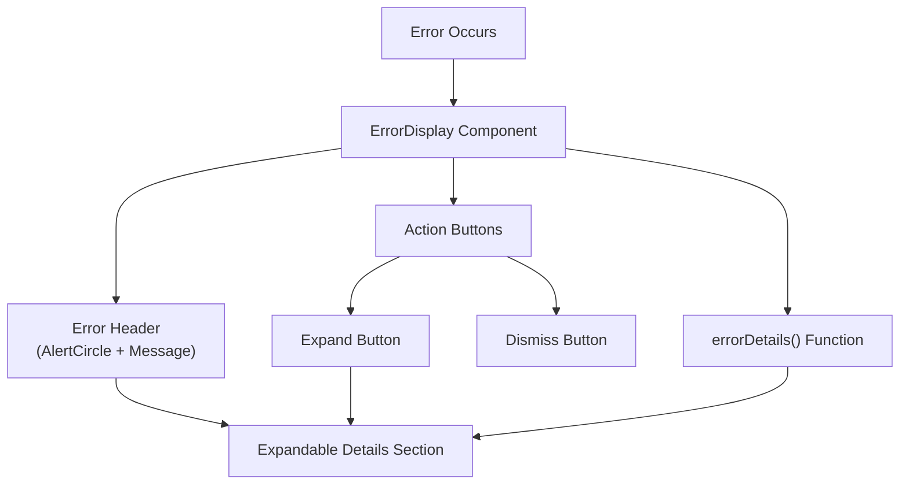
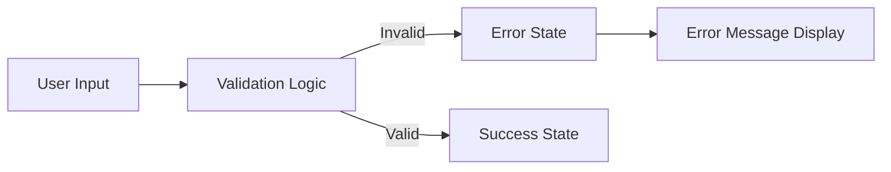
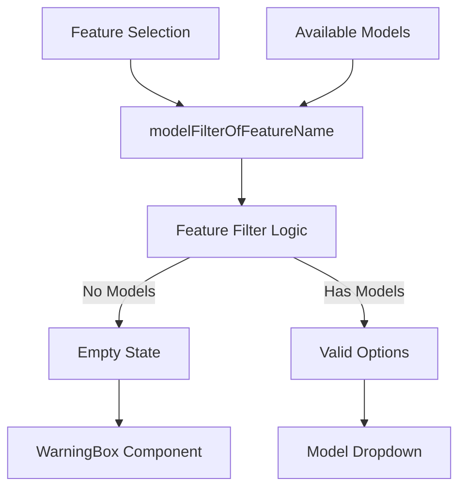
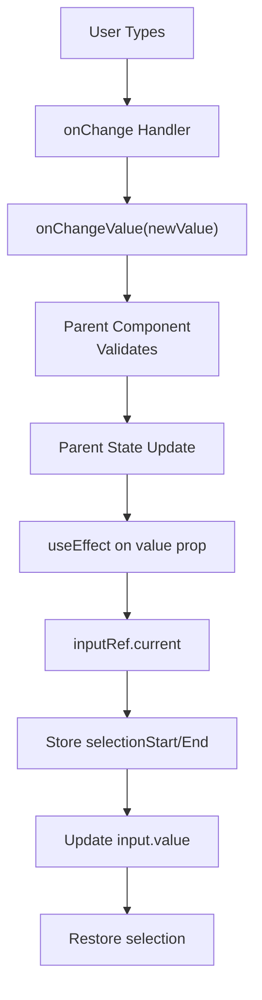
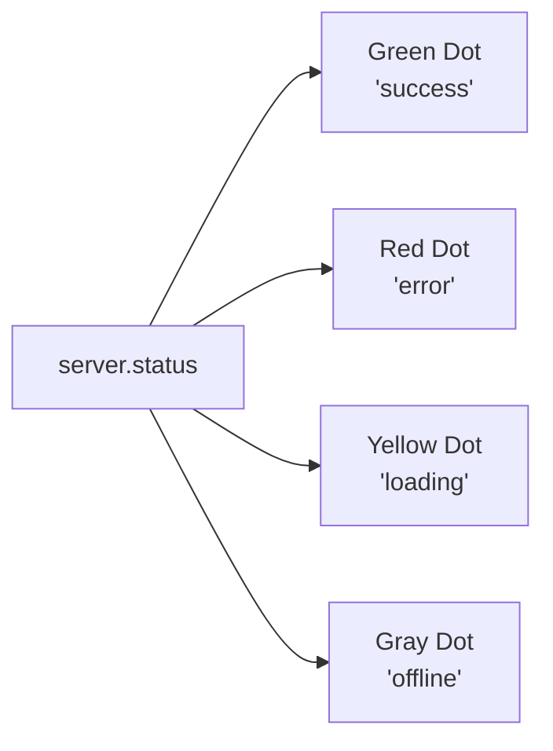

# Error Handling and UI Patterns

Relevant source files

The following files were used as context for generating this wiki page:

- [.voidrules](.voidrules)

This document covers error handling strategies and user interface patterns used throughout Void's React components. It explains how errors are displayed to users, how validation is performed in forms and inputs, how loading and success states are communicated, and the common UI patterns for preventing and handling errors gracefully.

For information about service-level error handling and IPC error propagation, see [LLM Message Pipeline and Dispatch](#4.1). For build-time validation and type safety, see [Build System and Pipeline](#5.1).

---

## Error Display Architecture

Void uses a layered approach to error handling, with different display mechanisms depending on the error context and severity.

### ErrorDisplay Component

The primary user-facing error component is `ErrorDisplay`, which provides an expandable interface for showing error messages with optional details.

**Sources:** [src/vs/workbench/contrib/void/browser/react/src/sidebar-tsx/ErrorDisplay.tsx:1-81]()

The `ErrorDisplay` component accepts:
- `message`: User-facing error message (string)
- `fullError`: Full Error object for detailed inspection
- `onDismiss`: Optional callback for dismissing the error
- `showDismiss`: Whether to show the dismiss button

The component uses the `errorDetails()` function from `sendLLMMessageTypes` to extract detailed error information [src/vs/workbench/contrib/void/browser/react/src/sidebar-tsx/ErrorDisplay.tsx:21-21](). If details are available, an expand/collapse button appears.

**Visual States:**
- **Collapsed**: Shows icon, title ("Error"), and message.
- **Expanded**: Additionally shows full error details in a `<pre>` block [src/vs/workbench/contrib/void/browser/react/src/sidebar-tsx/ErrorDisplay.tsx:64-75]().
- **Dismissible**: Shows X button when `showDismiss` is true [src/vs/workbench/contrib/void/browser/react/src/sidebar-tsx/ErrorDisplay.tsx:44-48]().

**Sources:** [src/vs/workbench/contrib/void/browser/react/src/sidebar-tsx/ErrorDisplay.tsx:12-81]()

---

## Validation Patterns

Void implements validation at multiple levels: input-level, form-level, and model-level.

### Input Validation Pattern

Input components perform real-time validation and display errors inline.

**Example: Model Settings Dialog Validation**
The `SimpleModelSettingsDialog` validates JSON input for model overrides:
1. User enters JSON in textarea [src/vs/workbench/contrib/void/browser/react/src/void-settings-tsx/Settings.tsx:241-247]().
2. On save, JSON is parsed [src/vs/workbench/contrib/void/browser/react/src/void-settings-tsx/Settings.tsx:254-254]().
3. If parsing fails, error message is set: `"Invalid JSON"` [src/vs/workbench/contrib/void/browser/react/src/void-settings-tsx/Settings.tsx:279-279]().
4. Only allowed keys are kept, and empty values are filtered out [src/vs/workbench/contrib/void/browser/react/src/void-settings-tsx/Settings.tsx:260-275]().

**Sources:** [src/vs/workbench/contrib/void/browser/react/src/void-settings-tsx/Settings.tsx:208-284]()

### Form Validation Pattern

Forms validate on submission and display errors below the form.

**Example: Add Model Form**
Validation rules enforced in `Settings.tsx`:
- Provider must be selected [src/vs/workbench/contrib/void/browser/react/src/void-settings-tsx/Settings.tsx:567-570]().
- Model name must be non-empty [src/vs/workbench/contrib/void/browser/react/src/void-settings-tsx/Settings.tsx:572-575]().
- Model name must not already exist for that provider [src/vs/workbench/contrib/void/browser/react/src/void-settings-tsx/Settings.tsx:577-580]().

**Sources:** [src/vs/workbench/contrib/void/browser/react/src/void-settings-tsx/Settings.tsx:562-587]()

### Model Selection Validation

Model dropdowns validate that selected models meet feature requirements using the `WarningBox` component.

Each feature (Chat, Ctrl+K, Autocomplete) can define a `filter` function and `emptyMessage` in the `modelFilterOfFeatureName` mapping [src/vs/workbench/contrib/void/browser/react/src/void-settings-tsx/ModelDropdown.tsx:50-73](). For example, Autocomplete requires FIM (Fill-In-Middle) support.

**Sources:** [src/vs/workbench/contrib/void/browser/react/src/void-settings-tsx/ModelDropdown.tsx:75-99](), [src/vs/workbench/contrib/void/browser/react/src/void-settings-tsx/ModelDropdown.tsx:50-73]()

---

## User Feedback Mechanisms

### Loading, Success, and Error States

Void provides immediate visual feedback for user actions through loading states and success animations.

**Refresh Model Button States:**
The `RefreshModelButton` component demonstrates the complete state cycle:
- `'idle'`: `RefreshCw` icon [src/vs/workbench/contrib/void/browser/react/src/void-settings-tsx/Settings.tsx:81-81]().
- `'refreshing'`: `Loader2` (spinning) [src/vs/workbench/contrib/void/browser/react/src/void-settings-tsx/Settings.tsx:79-79]().
- `'finished'`: `Check` (green) [src/vs/workbench/contrib/void/browser/react/src/void-settings-tsx/Settings.tsx:83-83]().
- `'error'`: `X` (red) [src/vs/workbench/contrib/void/browser/react/src/void-settings-tsx/Settings.tsx:85-85]().

**Sources:** [src/vs/workbench/contrib/void/browser/react/src/void-settings-tsx/Settings.tsx:48-96]()

### AnimatedCheckmarkButton

Provides visual feedback for successful actions with an SVG checkmark animation. It uses `strokeDashoffset` to create a drawing effect over 500ms [src/vs/workbench/contrib/void/browser/react/src/void-settings-tsx/Settings.tsx:125-144]().

**Sources:** [src/vs/workbench/contrib/void/browser/react/src/void-settings-tsx/Settings.tsx:115-158]()

---

## Confirmation Patterns

For destructive or irreversible actions, Void uses confirmation patterns to prevent accidental operations.

### ConfirmButton Component

A two-click confirmation pattern:
1. **First click**: Sets `confirm` state to true, changes button text to "Confirm..." [src/vs/workbench/contrib/void/browser/react/src/void-settings-tsx/Settings.tsx:189-192]().
2. **Click outside**: A listener resets `confirm` to false [src/vs/workbench/contrib/void/browser/react/src/void-settings-tsx/Settings.tsx:180-184]().
3. **Second click**: Executes the `onConfirm()` callback [src/vs/workbench/contrib/void/browser/react/src/void-settings-tsx/Settings.tsx:188-188]().

**Sources:** [src/vs/workbench/contrib/void/browser/react/src/void-settings-tsx/Settings.tsx:172-199]()

---

## Modal Dialog Patterns

### Modal Click Handling

The `SimpleModelSettingsDialog` uses a `mouseDownInsideModal` ref to track where the mouse down event originated [src/vs/workbench/contrib/void/browser/react/src/void-settings-tsx/Settings.tsx:219-219](). If a user starts a drag inside the modal but releases outside, the modal remains open, preventing accidental closure [src/vs/workbench/contrib/void/browser/react/src/void-settings-tsx/Settings.tsx:222-233]().

**Sources:** [src/vs/workbench/contrib/void/browser/react/src/void-settings-tsx/Settings.tsx:208-369]()

---

## Input Component Error Handling

### VoidSimpleInputBox Pattern

This component uses refs to maintain cursor position during validation to prevent the cursor from jumping to the end of the line when state updates [src/vs/workbench/contrib/void/browser/react/src/util/inputs.tsx:908-924]().

**Sources:** [src/vs/workbench/contrib/void/browser/react/src/util/inputs.tsx:881-934]()

---

## MCP Server Status Display

MCP servers show real-time status with visual indicators in the settings UI.

### Status Indicator System

The status is derived from the `IMCPServiceState` [src/vs/workbench/contrib/void/browser/react/src/void-settings-tsx/Settings.tsx:1007-1007](). If a server has an error, the error message is displayed directly below the server entry [src/vs/workbench/contrib/void/browser/react/src/void-settings-tsx/Settings.tsx:993-995]().

**Sources:** [src/vs/workbench/contrib/void/browser/react/src/void-settings-tsx/Settings.tsx:925-1030]()

---

## Styling Conventions

Error-related UI elements follow consistent styling patterns defined in Tailwind config and CSS variables.

| Pattern | Classes / Variables | Usage |
|---------|---------|-------|
| **Error Text** | `text-red-500` | Inline error messages [src/vs/workbench/contrib/void/browser/react/src/void-settings-tsx/Settings.tsx:279]() |
| **Warning** | `bg-void-warning` | `WarningBox` background [src/vs/workbench/contrib/void/browser/react/src/styles.css:93]() |
| **Success** | `stroke-green-500` | `AnimatedCheckmarkButton` [src/vs/workbench/contrib/void/browser/react/src/void-settings-tsx/Settings.tsx:142]() |
| **Disabled** | `opacity-50 cursor-not-allowed` | Disabled buttons/inputs [src/vs/workbench/contrib/void/browser/react/src/void-settings-tsx/Settings.tsx:562]() |

**Sources:** [src/vs/workbench/contrib/void/browser/react/src/styles.css:1-101](), [src/vs/workbench/contrib/void/browser/react/tailwind.config.js:1-199](), [src/vs/workbench/contrib/void/browser/react/src/void-settings-tsx/Settings.tsx:115-158]()